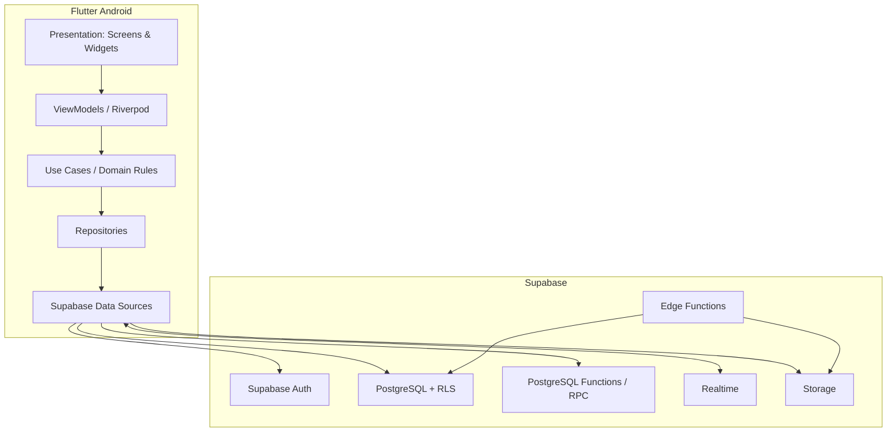
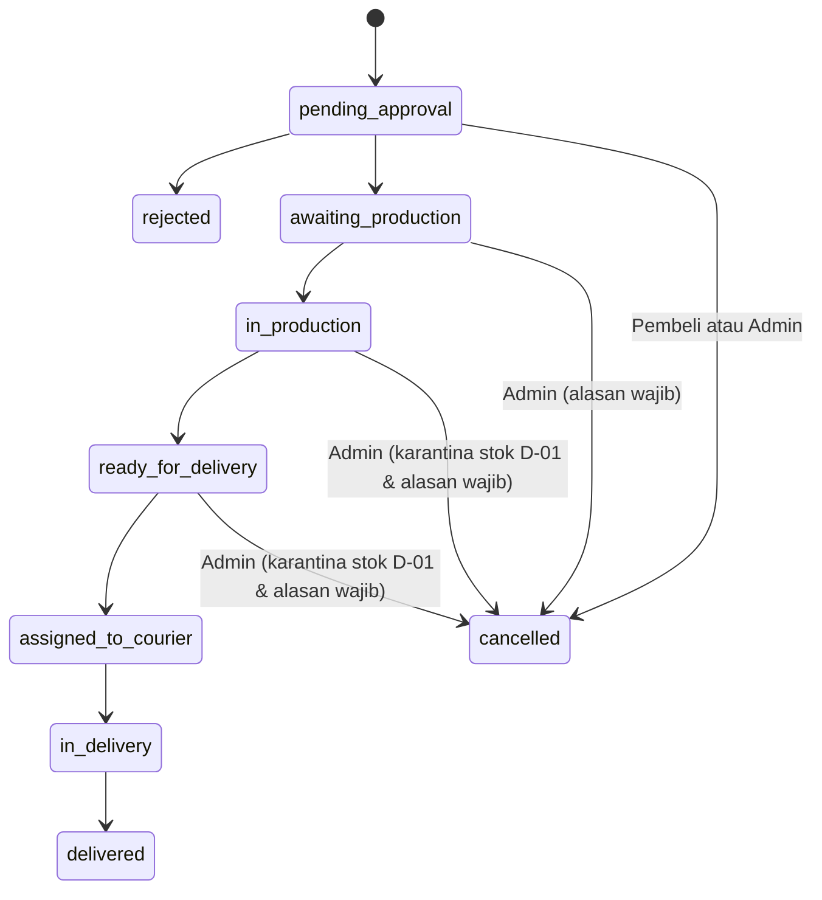

# ARCHITECTURE.md

## 1. Tujuan

Dokumen ini menetapkan arsitektur teknis aplikasi Kulit Lumpia. Targetnya adalah aplikasi Android yang mudah dirawat, dapat diuji, dan menjaga konsistensi transaksi dari checkout sampai barang diterima.

## 2. Gambaran Arsitektur

Kulit Lumpia menggunakan Flutter sebagai client dan Supabase sebagai backend terkelola.



Flutter tidak menjadi sumber kebenaran untuk harga, stok, pembayaran, role, atau transisi status. Sumber kebenaran transaksi berada di PostgreSQL dan fungsi server-side.

## 3. Prinsip Arsitektur

1. Feature-first: kode dikelompokkan berdasarkan kemampuan produk.
2. Layered: UI, domain, dan data memiliki tanggung jawab terpisah.
3. MVVM: View menampilkan state dan meneruskan intent; ViewModel mengatur state dan alur presentasi.
4. Repository pattern: UI tidak mengetahui detail query Supabase.
5. Server-authoritative: keputusan bisnis kritis diputuskan dan divalidasi server.
6. Least privilege: setiap role mendapat akses minimum yang dibutuhkan.
7. Explicit state transition: perubahan status mengikuti transisi yang sah.
8. Observable operations: tindakan penting memiliki histori dan audit.

## 4. Struktur Folder

```text
lib/
├── app/
│   ├── app.dart
│   ├── bootstrap.dart
│   ├── router/
│   └── theme/
├── core/
│   ├── config/
│   ├── constants/
│   ├── errors/
│   ├── extensions/
│   ├── formatters/
│   ├── network/
│   ├── result/
│   └── widgets/
├── shared/
│   ├── models/
│   ├── services/
│   └── widgets/
├── features/
│   ├── auth/
│   ├── profile/
│   ├── addresses/
│   ├── catalog/
│   ├── cart/
│   ├── checkout/
│   ├── orders/
│   ├── payments/
│   ├── admin/
│   ├── production/
│   ├── delivery/
│   ├── notifications/
│   └── reports/
└── main.dart

supabase/
├── config.toml
├── migrations/
├── functions/
└── tests/
```

Struktur internal feature:

```text
feature_name/
├── data/
│   ├── datasources/
│   ├── models/
│   └── repositories/
├── domain/
│   ├── entities/
│   ├── repositories/
│   └── usecases/
└── presentation/
    ├── pages/
    ├── providers/
    └── widgets/
```

Tidak semua feature wajib memiliki semua folder. Hindari folder kosong dan lapisan yang hanya meneruskan pemanggilan tanpa memberi nilai.

## 5. Tanggung Jawab Lapisan

### Presentation
- Menampilkan data.
- Mengelola interaksi pengguna.
- Menampilkan loading/error/empty/success.
- Memanggil method ViewModel/Notifier.
- Tidak berisi query SQL/Supabase atau aturan transaksi.

### ViewModel / Riverpod Notifier
- Mengelola state layar.
- Memanggil use case/repository.
- Mengubah hasil operasi menjadi state UI.
- Tidak menjadi tempat menyimpan seluruh aturan bisnis aplikasi.

### Domain
- Entity dan value object.
- Aturan validasi bisnis yang dapat diuji tanpa Flutter.
- Kontrak repository.
- Use case untuk proses yang memiliki alur atau aturan bermakna.

### Data
- Implementasi repository.
- Supabase query/RPC.
- DTO dan mapper.
- Upload/download Storage.
- Translasi error backend menjadi error aplikasi yang terdefinisi.

## 6. Batas Fitur

| Feature | Tanggung jawab |
|---|---|
| auth | Login, registrasi pembeli, logout, reset password, session |
| profile | Data profil dan role yang dibaca secara aman |
| addresses | Alamat pengiriman pembeli |
| catalog | Produk, varian, harga, ketersediaan |
| cart | Pilihan item sebelum checkout |
| checkout | Validasi input dan pembuatan pesanan |
| orders | Daftar/detail pesanan dan timeline |
| payments | Bukti transfer, verifikasi, pencatatan COD |
| admin | Review pesanan, pengelolaan master data, penugasan |
| production | Antrean dan penyelesaian proses |
| delivery | Assignment, status pengiriman, bukti penerimaan |
| notifications | Inbox dan status baca |
| reports | Ringkasan dan laporan operasional |

Jangan menempatkan semua fungsi admin dalam satu file besar. Pisahkan berdasarkan kemampuan yang nyata.

## 7. Model Domain Utama

Entitas konseptual:
- UserProfile
- Address
- Product
- ProductVariant
- Inventory
- InventoryMovement
- CartItem
- Order
- OrderItem
- Payment
- PaymentVerification
- ProductionJob atau ProductionRecord
- DeliveryAssignment
- DeliveryProof
- OrderStatusHistory
- Notification
- ActivityLog

`Order` menyimpan data header dan snapshot total. `OrderItem` menyimpan snapshot nama produk/varian, harga per lembar, dan kuantitas. Perubahan katalog tidak boleh mengubah transaksi historis.

## 8. State Machine

### Status pesanan (9 Status Resmi Terkunci)



Aturan Transisi Status Pesanan:
- **Tepat 9 Status Resmi:** `pending_approval`, `rejected`, `awaiting_production`, `in_production`, `ready_for_delivery`, `assigned_to_courier`, `in_delivery`, `delivered`, `cancelled`. Status `awaiting_courier` dihapus/dilarang karena redundan dengan `ready_for_delivery`.
- **Aturan Pembatalan (D-01 & D-02):**
  - Pembeli HANYA boleh membatalkan saat status `pending_approval`.
  - Admin dapat membatalkan pesanan pada status `pending_approval`, `awaiting_production`, `in_production`, atau `ready_for_delivery` dengan alasan wajib.
  - Sisa barang hasil produksi dari pesanan yang dibatalkan pada status `in_production` atau `ready_for_delivery` wajib masuk alur karantina/pemeriksaan kelayakan oleh Admin/Kepala Karyawan (D-01), tidak boleh otomatis masuk stok siap jual.
- **Terminal Status:** `rejected`, `delivered`, dan `cancelled`.

Status pembayaran merupakan state machine terpisah:
- `unpaid`
- `proof_submitted`
- `paid`
- `payment_rejected`
- `cod_pending`
- `cod_collected`
- `refunded`

Metode pembayaran (`bank_transfer`, `cod`) juga disimpan terpisah dari status pembayaran.

## 9. Kontrak Operasi Server

Operasi yang dijalankan secara atomik melalui PostgreSQL RPC:

| Operasi | Pemeriksaan & Validasi Minimum |
|---|---|
| `create_order` | Harga aktif varian, kuantitas valid (>=10 & kelipatan 10), alamat lengkap, total dihitung server, bukti transfer terlampir jika metode transfer (D-07) |
| `approve_order` | Role admin, status sebelumnya `pending_approval`, alokasi stok (`reserved`) dan kebutuhan produksi dihitung atomik |
| `reject_order` | Role admin, status sebelumnya `pending_approval`, alasan penolakan wajib dicatat |
| `start_production` | Role kepala karyawan, status sebelumnya `awaiting_production`, pesanan sah |
| `complete_production` | Role kepala karyawan, kuantitas siap diverifikasi, transisi status ke `ready_for_delivery` |
| `assign_courier` | Role admin, pengirim aktif terdaftar, status sebelumnya `ready_for_delivery`, transisi ke `assigned_to_courier` |
| `start_delivery` | Pengirim yang ditugaskan (`auth.uid() = courier_id`), status sebelumnya `assigned_to_courier`, transisi ke `in_delivery` |
| `report_cod_receipt` | Pengirim yang ditugaskan, mencatat laporan penerimaan uang fisik dari pembeli di lapangan (Tahap 1 konfirmasi COD) |
| `confirm_delivery` | Pengirim yang ditugaskan, status sebelumnya `in_delivery`, wajib melampirkan foto bukti penerimaan dan nama penerima barang (catatan opsional) (D-06), transisi ke `delivered` |
| `verify_transfer_payment` | Role admin, verifikasi bukti struk dan nominal mutasi rekening bank, status pembayaran `proof_submitted` -> `paid` atau `payment_rejected` |
| `record_cod_payment` | Role admin, verifikasi fisik setoran uang COD dari kurir (Tahap 2 konfirmasi COD), status pembayaran `cod_pending` -> `cod_collected` |
| `process_refund` | Role admin, pengembalian manual via transfer bank dicatat (nominal, tanggal, referensi transaksi, catatan, dan foto bukti transfer jika ada) (D-03), status pembayaran -> `refunded` |
| `cancel_order` | Role pembeli (hanya saat `pending_approval`) atau role admin (dengan alasan wajib); pelepasan alokasi stok dan inisiasi proses karantina sisa produksi jika barang sudah diproduksi (D-01) |

Jangan menyediakan endpoint generik yang menerima `order_id` dan `new_status` tanpa memvalidasi aktor, status sebelumnya, dan aturan transisi.

## 10. Alur Data

### Checkout
1. Flutter mengirim varian, kuantitas, alamat, metode pembayaran, dan bukti transfer bila diperlukan.
2. Server memvalidasi varian aktif, minimum 10, kelipatan 10, alamat, dan metode pembayaran.
3. Server mengambil harga terbaru dari database.
4. Server menghitung total.
5. Server membuat order dan item snapshot.
6. Server membuat catatan pembayaran.
7. Server membuat histori status dan notifikasi.
8. Flutter menerima ringkasan pesanan yang dibuat.

### Realtime
- Realtime digunakan untuk menyegarkan daftar atau detail ketika ada perubahan.
- Event bukan sumber otorisasi.
- UI harus menangani event duplikat dan data yang datang tidak berurutan.
- Data sensitif tetap diambil melalui query yang dilindungi RLS.

## 11. Database dan Migration

- Migration berada di `supabase/migrations`.
- Nama migration memakai timestamp dan deskripsi singkat.
- Setiap perubahan schema, policy, trigger, function, dan index harus tercatat.
- Uji migration pada environment development.
- Hindari perubahan manual yang tidak dapat direproduksi.
- Gunakan foreign key, unique constraint, check constraint, dan index yang sesuai.
- Nominal Rupiah menggunakan integer/bigint.
- Waktu menggunakan `timestamptz`.
- Nomor pesanan dibuat server-side dan dijamin unik.

## 12. Dependency Management

- Riverpod untuk state dan dependency injection.
- GoRouter untuk routing.
- `supabase_flutter` untuk akses Supabase.
- Freezed/JSON Serializable bila memberi manfaat pada model.
- `intl` untuk format Rupiah dan tanggal.
- Tambahkan package setelah memeriksa maintenance, kompatibilitas, lisensi, dan kebutuhan.

## 13. Error Handling

Gunakan kategori error yang dapat dipahami:
- ValidationFailure
- AuthenticationFailure
- AuthorizationFailure
- NetworkFailure
- NotFoundFailure
- ConflictFailure
- StorageFailure
- ServerFailure
- UnknownFailure

Pesan teknis internal tidak ditampilkan mentah kepada pembeli. Simpan detail diagnostik yang aman tanpa token, secret, atau data pribadi berlebihan.

## 14. Testing Architecture

- Unit test untuk domain rules dan perhitungan.
- Repository test untuk mapping dan penanganan error.
- Widget test untuk state layar.
- Integration test untuk alur checkout hingga delivered.
- Database/RLS test untuk setiap role.
- Concurrency test untuk alokasi stok dan operasi sensitif.

## 15. Keputusan Bisnis yang Telah Dikunci pada Stage 0.2 (D-01 s/d D-07)

Seluruh keputusan bisnis arsitektural telah disetujui resmi oleh Product Owner dan terkunci sebagai acuan implementasi:
- **D-01 — Penanganan Sisa Produksi Pesanan Batal:** Sisa produksi pesanan batal masuk proses karantina/pemeriksaan kelayakan oleh Admin/Kepala Karyawan; barang layak jual kembali ke stok (`inventory.on_hand += qty`), barang tidak layak dicatat sebagai *waste*; seluruh mutasi dicatat di audit log.
- **D-02 — Batas Pembatalan Mandiri Pembeli:** Pembeli HANYA boleh membatalkan pesanan saat status `pending_approval`. Setelah disetujui admin, pembatalan mandiri dilarang (harus hubungi admin). Admin berwenang membatalkan dengan alasan wajib.
- **D-03 — Refund Transfer:** Refund transfer dilakukan manual oleh admin via transfer bank dengan pencatatan lengkap (nominal, tanggal, referensi transaksi, catatan, dan bukti transfer jika ada). Status pembayaran `refunded` hanya setelah transfer dicatat oleh admin, tidak otomatis saat pesanan batal.
- **D-04 — Struktur Varian Produk:** Menggunakan Generic Variant Structure (`products` 1-to-many `product_variants`). Atribut minimum: `id`, `product_id`, `name`, `sku`, `price_per_piece` (bigint Rupiah), `is_active`. Tidak membuat kolom spesifik `diameter_cm`/`thickness`/`type` sebagai struktur wajib database.
- **D-05 — Pembuatan Akun Staf:** Registrasi publik HANYA untuk role `buyer`. Akun staf (`admin`, `production_lead`, `courier`) dibuat secara tertutup oleh admin; form registrasi tanpa pilihan role; default role database adalah `buyer`.
- **D-06 — Bukti Pengiriman/Penerimaan:** Bukti pengiriman wajib terdiri dari foto bukti penerimaan dan nama penerima barang (catatan opsional). Keduanya wajib sebelum konfirmasi `delivered`.
- **D-07 — Batas Waktu Pembayaran & Verifikasi:** Bukti transfer wajib diunggah saat checkout. Tidak ada auto-cancel timeout pembayaran pada MVP. Admin verifikasi manual (tolak dengan alasan wajib jika tidak valid). Ketentuan SLA operasional verifikasi belum ditetapkan angka finalnya dan tidak menggunakan timer pembatalan otomatis.
- **Konfirmasi COD 2-Tahap:** Kurir lapor penerimaan fisik (tahap 1), Admin verifikasi setoran fisik ke `cod_collected` (tahap 2). Status pengiriman (`delivered`) dan status pembayaran (`cod_collected`) dipisahkan secara tegas.
- **Status Pesanan Tepat 9:** `pending_approval`, `rejected`, `awaiting_production`, `in_production`, `ready_for_delivery`, `assigned_to_courier`, `in_delivery`, `delivered`, `cancelled`. Status `awaiting_courier` telah dihapus.
