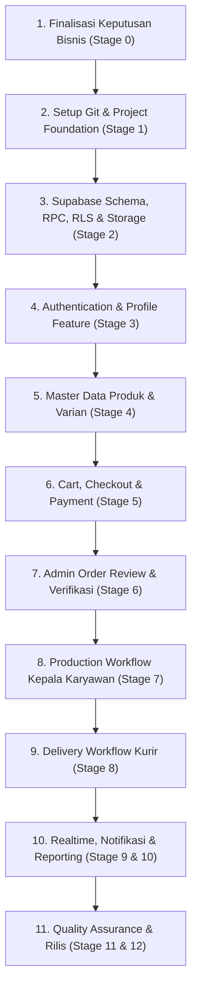

# LAPORAN AUDIT MENYELURUH (COMPREHENSIVE AUDIT REPORT)
**Proyek:** Kulit Lumpia Mobile Application  
**Target Platform:** Android  
**Framework:** Flutter (Dart)  
**Backend:** Supabase (Auth, PostgreSQL, Storage, Realtime, RPC)  
**Tanggal Audit:** 17 November 2026  
**Auditor:** Senior Flutter Engineer, Supabase Architect, & Software Auditor  
**Status Audit:** Selesai (Read-Only Audit)  

---

## 1. Ringkasan Kondisi Proyek

Berdasarkan audit teknis dan pemeriksaan menyeluruh terhadap workspace `e:\Software-Enginer\Mobile Developer\kulit_lumpia`, disimpulkan bahwa **proyek saat ini berada pada Status Pra-Implementasi / Tahap Spesifikasi & Desain Arsitektur (Stage 0 — Finalisasi Produk)**.

### Kondisi Utama:
1. **Dokumentasi Spesifikasi Sangat Komprehensif:** Proyek memiliki 9 dokumen acuan teknis dan operasional yang sangat matang dan terstruktur rapi di root direktori (`PRD.md`, `TECHSTACK.md`, `ARCHITECTURE.md`, `SECURITY.md`, `DESIGN.md`, `STYLEGUIDE.md`, `SKILLS.md`, `TASK.md`, dan `AGENTS.md`). Dokumen-dokumen ini menetapkan aturan bisnis, arsitektur *Feature-First*, tata kelola keamanan *server-authoritative*, serta panduan UI/UX.
2. **Belum Ada Source Code Aplikasi / Scaffold Flutter:** Tidak ditemukan file `pubspec.yaml`, folder `lib/`, file Dart (`.dart`), aset, maupun konfigurasi platform Android (`android/`).
3. **Belum Ada Migrasi Database & Konfigurasi Supabase:** Tidak ditemukan folder `supabase/`, migration file (`.sql`), konfigurasi `config.toml`, Edge Functions, maupun environment variable (`.env`).
4. **Belum Ada Inisialisasi Version Control:** Direktori workspace belum diinisialisasi sebagai repositori Git (tidak ditemukan folder `.git` maupun file `.gitignore`).
5. **Keputusan Bisnis Terbuka (Open Questions):** Terdapat 7 isu bisnis fundamental pada `PRD.md` Bagian 18 yang belum difinalisasi (antara lain batas pembatalan mandiri pembeli, penanganan sisa produksi yang dibatalkan, dan detail varian produk) yang berpotensi memicu perubahan skema jika implementasi dimulai sebelum dikunci.
6. **Hasil Testing:** Perintah `flutter analyze` melaporkan `No issues found! (ran in 0.3s)` semata-mata karena tidak ada file Dart untuk dianalisis. Perintah `flutter test` gagal dengan exit code 1 (`Test directory "test" not found.`).

---

## 2. Struktur Direktori Aktual

Pemeriksaan sistem file secara rekursif (`Get-ChildItem -Path "E:\Software-Enginer\Mobile Developer\kulit_lumpia" -Recurse -Force`) menunjukkan **hanya terdapat 9 file Markdown** tanpa adanya subfolder:

```text
E:\Software-Enginer\Mobile Developer\kulit_lumpia\
├── AGENTS.md          (Instruksi kerja AI agent & developer - 7.289 bytes)
├── ARCHITECTURE.md    (Spesifikasi teknis & arsitektur sistem - 10.308 bytes)
├── DESIGN.md          (Prinsip UI/UX & tata letak aplikasi - 7.331 bytes)
├── PRD.md             (Product Requirements Document - 27.404 bytes)
├── SECURITY.md        (Spesifikasi & kebijakan keamanan data - 9.046 bytes)
├── SKILLS.md          (Daftar kompetensi teknis & best practices - 5.551 bytes)
├── STYLEGUIDE.md      (Standar token warna, tipografi, dan kontrol - 6.979 bytes)
├── TASK.md            (Roadmap & checklist tahapan implementasi - 10.222 bytes)
└── TECHSTACK.md       (Keputusan stack teknologi & dependensi - 15.047 bytes)
```

### Elemen yang Belum Ada di File System:
- `.git/` & `.gitignore`
- `pubspec.yaml` & `pubspec.lock`
- `analysis_options.yaml`
- `android/` (Gradle, AndroidManifest.xml, build configurations)
- `lib/` (Entrypoint `main.dart`, `app/`, `core/`, `shared/`, `features/`)
- `test/` (Unit test, widget test, mocks)
- `supabase/` (`config.toml`, `migrations/`, `seed.sql`, `functions/`)
- `.env` / `.env.example`

---

## 3. Fitur yang Sudah Selesai

**Status Implementasi Source Code: 0% (Belum Ada Fitur yang Selesai Diprogram).**

Namun demikian, pada tingkat **Spesifikasi, Kebijakan, dan Perancangan Arsitektur**, aspek-aspek berikut telah selesai didefinisikan secara tuntas:
- **Baseline Aturan Bisnis Transaksi:** Minimum 10 lembar, kelipatan 10, ongkir Rp0, format nomor pesanan `ORD-YYYYMMDD-XXXX` (`PRD.md` L51–L79).
- **State Machine Transaksi & Pembayaran:** 9 status pesanan (`pending_approval` s/d `delivered`) dan 7 status pembayaran terpisah (`unpaid` s/d `refunded`) (`PRD.md` L289–L323; `ARCHITECTURE.md` L190–L223).
- **Spesifikasi Kontrak Atomik Server (RPC):** Kontrak untuk 11 fungsi RPC kritis telah dipetakan (`ARCHITECTURE.md` L224–L242).
- **Matriks Hak Akses & Role (RLS):** 4 role (`buyer`, `admin`, `production_lead`, `courier`) beserta matriks izin akses data (`SECURITY.md` L45–L89).
- **Spesifikasi Storage Bucket & Privacy:** Bucket `product-images` (publik), `payment-proofs` (privat via signed URL), dan `delivery-proofs` (privat via signed URL) (`SECURITY.md` L140–L154).
- **Design System & Styleguide:** Token warna semantik, skala spacing kelipatan 4dp, hierarki tipografi, dan aturan button verb (`DESIGN.md`, `STYLEGUIDE.md`).

---

## 4. Fitur yang Masih Parsial

**Tidak ada fitur parsial pada kode (karena belum ada kode yang ditulis).**

Pada tingkat **Perancangan Konseptual**, fitur-fitur berikut berada dalam status **Parsial / Memerlukan Finalisasi Keputusan (Open Questions)**:
1. **Penanganan Stok Pasca Pembatalan:** Kebijakan penanganan sisa kulit lumpia yang sudah diproduksi ketika pesanan dibatalkan setelah persetujuan admin belum dikunci (`PRD.md` L383–L391, L731–L732).
2. **Batas Pembatalan Mandiri Pembeli:** Belum ada batas status pasti kapan pembeli masih dapat membatalkan pesanan secara mandiri (`PRD.md` L403–L414, L732–L733).
3. **Mekanisme Refund Transfer:** Prosedur dan wewenang pencatatan pengembalian dana jika pesanan transfer dibatalkan belum ditetapkan (`PRD.md` L400–L402, L733).
4. **Atribut Varian Produk:** Atribut spesifik (apakah diameter, ketebalan, atau jenis bahan) masih berstatus contoh dan belum ditentukan secara tetap oleh pemilik produk (`PRD.md` L358–L361, L734).
5. **SLA Verifikasi Bukti Transfer:** Belum ada batas waktu kedaluwarsa verifikasi sebelum pesanan dibatalkan otomatis (`PRD.md` L737–L738; `TASK.md` L24).
6. **Mekanisme Pelaporan Uang COD oleh Pengirim:** Belum ada rincian apakah pengirim memiliki form lapor penerimaan uang tunai atau hanya admin yang mencatat secara langsung (`PRD.md` L341–L349, L735–L736).

---

## 5. Fitur yang Belum Tersedia

Seluruh fitur operasional dan antarmuka pengguna belum tersedia di level implementasi kode (Tahap 1 s/d Tahap 12 pada `TASK.md` belum dimulai):

| Kategori Fitur | Status Kode | Rujukan Spesifikasi | Kebutuhan Utama yang Harus Dibangun |
|---|---|---|---|
| **Infrastruktur & Auth** | Belum Ada | `PRD.md` L123–L163; `TASK.md` L73–L87 | Setup Flutter, GoRouter guard, Riverpod, Supabase Auth (Buyer register, all roles login, reset password). |
| **Profil & Alamat** | Belum Ada | `PRD.md` L418–L430; `TASK.md` L80, L108 | CRUD alamat lengkap rumah (nama, telp, kecamatan, kota, provinsi), profil pengguna. |
| **Katalog & Varian** | Belum Ada | `PRD.md` L358–L370; `TASK.md` L88–L101 | Tampilan produk, varian, harga/lembar, info ketersediaan stok, upload foto produk. |
| **Keranjang & Checkout** | Belum Ada | `PRD.md` L204–L218; `TASK.md` L103–L120 | Validasi kuantitas (>= 10 & kelipatan 10), kalkulasi total server-side, upload bukti transfer saat checkout, COD. |
| **Manajemen Pesanan Admin** | Belum Ada | `PRD.md` L219–L226; `TASK.md` L122–L136 | Dashboard admin, approve/reject pesanan berargumen alasan, verifikasi bukti transfer, pencatatan COD. |
| **Alur Produksi (Kepala Karyawan)** | Belum Ada | `PRD.md` L227–L238; `TASK.md` L138–L152 | Antrean pesanan masuk, start production, catatan kendala, finish production ke `ready_for_delivery`. |
| **Alur Pengiriman (Pengirim)** | Belum Ada | `PRD.md` L239–L260; `TASK.md` L153–L167 | Penugasan pengirim oleh admin, antrean tugas kurir, start delivery, upload bukti serah terima (foto), konfirmasi `delivered`. |
| **Notifikasi & Realtime** | Belum Ada | `PRD.md` L443–L460; `TASK.md` L169–L183 | In-app notification inbox, subscription Realtime Supabase, penandaan status baca. |
| **Laporan & Audit Log** | Belum Ada | `PRD.md` L500–L502; `TASK.md` L184–L198 | Audit logging mutasi data sensitif, rekap penjualan/produksi/pengiriman. |

---

## 6. Temuan Arsitektur

### Temuan A-01: Proyek Belum Memiliki Kerangka Proyek Flutter (Project Scaffolding)
- **Lokasi File:** Root workspace `E:\Software-Enginer\Mobile Developer\kulit_lumpia`
- **Bukti Implementasi:**
  - Tidak ditemukan `pubspec.yaml`.
  - Direktori `lib/`, `test/`, dan `android/` tidak ada.
  - Perintah `flutter analyze` berjalan 0.3 detik tanpa memvalidasi struktur Dart apa pun.
- **Dampak:** Tidak ada kode sumber yang dapat dieksekusi, diuji, maupun di-build ke Android APK.
- **Rekomendasi Perbaikan:**
  Inisialisasi project Flutter Android dengan package name `com.kulitlumpia.app` sesuai standar arsitektur pada `ARCHITECTURE.md` Bagian 4.

### Temuan A-02: Belum Diterapkannya Pemisahan Layer Feature-First
- **Lokasi File:** `lib/` (belum ada) vs `ARCHITECTURE.md` L53–L117
- **Bukti Implementasi:**
  `ARCHITECTURE.md` mensyaratkan pemisahan direktori:
  ```text
  lib/
  ├── app/
  ├── core/
  ├── shared/
  └── features/
      ├── auth/
      ├── profile/
      ├── addresses/
      ├── catalog/
      ├── cart/
      ├── checkout/
      ├── orders/
      ├── payments/
      ├── admin/
      ├── production/
      ├── delivery/
      ├── notifications/
      └── reports/
  ```
  Struktur ini saat ini baru berupa diagram teks.
- **Dampak:** Risiko implementasi menyimpang dari pola *Layered MVVM + Feature-First* jika developer langsung membuat file tanpa struktur folder baku.
- **Rekomendasi Perbaikan:**
  Buat struktur direktori baseline lengkap dengan kontrak layer (`data/`, `domain/`, `presentation/`) saat inisialisasi Stage 1.

### Temuan A-03: Ketiadaan Repositori Version Control (Git)
- **Lokasi File:** Root workspace `.git`
- **Bukti Implementasi:**
  Eksekusi shell `git status` menghasilkan pesan:
  `fatal: not a git repository (or any of the parent directories): .git`
- **Dampak:** Perubahan kode tidak terlacak, tidak ada branching model, dan tidak ada perlindungan terhadap regresi atau kehilangan berkas.
- **Rekomendasi Perbaikan:**
  Jalankan `git init`, buat `.gitignore` standar Flutter/Dart/Supabase, dan lakukan commit awal dokumen arsitektur sebelum penulisan kode dimulai.

---

## 7. Temuan Keamanan

### Temuan S-01: Row Level Security (RLS) dan Policies Belum Aktif di Database
- **Lokasi File:** `supabase/migrations/` (belum ada) vs `SECURITY.md` L63–L90
- **Bukti Implementasi:**
  Tidak ada migration script SQL yang mengeksekusi `ALTER TABLE ... ENABLE ROW LEVEL SECURITY;` maupun pembuatan policy per role (`buyer`, `admin`, `production_lead`, `courier`).
- **Dampak:** Jika API Supabase dihubungkan tanpa RLS, seluruh tabel dapat dibaca atau dimanipulasi secara bebas oleh pengguna mana pun yang memiliki Anon Key.
- **Rekomendasi Perbaikan:**
  Terapkan prinsip *Deny by Default*. Setiap tabel dalam migrasi SQL awal wajib disertai perintah pengaktifan RLS dan policy berbasis role dan ownership sebelum endpoint diakses oleh Flutter.

### Temuan S-02: Risiko Kalkulasi Harga dan Status Client-Authoritative Jika Tidak Ditegakkan Server-Side
- **Lokasi File:** `SECURITY.md` L101–L127; `PRD.md` L73–L79; `ARCHITECTURE.md` L224–L242
- **Bukti Implementasi:**
  `PRD.md` dan `SECURITY.md` dengan tegas melarang klien menghitung total harga final atau mengubah status secara bebas. Namun, stored procedure / RPC `create_order`, `approve_order`, dll. belum ditulis dalam bentuk migration PostgreSQL.
- **Dampak:** Potensi manipulasi harga barang, manipulasi nominal pembayaran, manipulasi kuantitas pesanan, atau eskalasi status sepihak oleh klien jika backend hanya mengandalkan direct table mutation via Supabase client SDK.
- **Rekomendasi Perbaikan:**
  Seluruh aksi pembuatan pesanan, kalkulasi harga, alokasi stok, dan perubahan status wajib diimplementasikan menggunakan PostgreSQL Function (RPC) dengan transaksi atomik dan pengecekan role internal (`auth.uid()`).

### Temuan S-03: Belum Tersedianya Konfigurasi Bucket Storage Privat
- **Lokasi File:** `SECURITY.md` L140–L154
- **Bukti Implementasi:**
  Bucket `payment-proofs` dan `delivery-proofs` belum dibuat. Kebijakan RLS Storage untuk membatasi akses unduh bukti transfer hanya untuk admin dan pemilik pesanan belum tertulis dalam migration.
- **Dampak:** Bukti transfer rekening dan foto penerimaan rumah pelanggan berisiko terekspos ke publik jika bucket salah dikonfigurasi sebagai publik.
- **Rekomendasi Perbaikan:**
  Tulis skrip migrasi Storage Supabase yang menetapkan bucket privat (`public = false`) dan batasi akses unduh menggunakan Signed URL dengan batas waktu singkat (misal 5–15 menit).

### Temuan S-04: Potensi Kebocoran Service Role Key
- **Lokasi File:** `SECURITY.md` L91–L100
- **Bukti Implementasi:**
  Belum ada file `.env.example` yang membedakan penempatan `SUPABASE_URL`, `SUPABASE_ANON_KEY` (client-safe dengan RLS) versus `SUPABASE_SERVICE_ROLE_KEY` (server-side only, pantang masuk ke APK).
- **Dampak:** Developer berpotensi keliru menyertakan `service_role` key ke dalam aplikasi mobile Android, yang akan mem-bypass seluruh sistem RLS.
- **Rekomendasi Perbaikan:**
  Siapkan template `.env.example` yang jelas dan pastikan kode Flutter hanya mengonsumsi publishable anon key.

---

## 8. Temuan Database dan Supabase

### Temuan D-01: Belum Ada Schema & Migration DDL (PostgreSQL)
- **Lokasi File:** Direktori `supabase/` (belum ada) vs `PRD.md` L526–L560
- **Bukti Implementasi:**
  `PRD.md` dan `ARCHITECTURE.md` mendefinisikan 15 tabel relasional:
  1. `profiles`
  2. `addresses`
  3. `products`
  4. `product_variants`
  5. `inventory`
  6. `inventory_movements`
  7. `orders`
  8. `order_items`
  9. `order_status_history`
  10. `payments`
  11. `payment_verifications`
  12. `delivery_assignments`
  13. `delivery_proofs`
  14. `notifications`
  15. `activity_logs`
  
  Tidak ada satu pun file DDL SQL di repositori.
- **Dampak:** Backend Supabase belum siap menerima koneksi, query, maupun uji integrasi dari aplikasi mobile.
- **Rekomendasi Perbaikan:**
  Inisialisasi Supabase CLI (`supabase init`) dan buat migration modular di `supabase/migrations/` dengan menyertakan Foreign Key, Unique Constraint, Check Constraint (misal `quantity >= 10 AND quantity % 10 = 0`), Index performa, dan tipe data `timestamptz` serta `bigint` untuk nominal rupiah.

### Temuan D-02: Stored Procedure / RPC Belum Dibuat
- **Lokasi File:** `ARCHITECTURE.md` L224–L242
- **Bukti Implementasi:**
  Daftar RPC esensial yang belum diimplementasikan:
  - `create_order`
  - `approve_order`
  - `reject_order`
  - `start_production`
  - `complete_production`
  - `assign_courier`
  - `start_delivery`
  - `confirm_delivery`
  - `verify_transfer_payment`
  - `record_cod_payment`
  - `cancel_order`
- **Dampak:** Alur operasional bisnis tidak dapat dijalankan secara atomik dan rentan *race condition* (misalnya alokasi stok ganda pada waktu bersamaan).
- **Rekomendasi Perbaikan:**
  Implementasikan fungsi-fungsi PL/pgSQL dengan transaksi atomik (`BEGIN ... COMMIT`) dan *concurrency lock* (`SELECT ... FOR UPDATE`) pada pemesanan dan mutasi stok.

---

## 9. Temuan Testing dan Kualitas Kode

### Temuan T-01: Kegagalan Menjalankan Test Suite (`flutter test`)
- **Lokasi File:** Root directory / direktori `test/` (tidak ada)
- **Bukti Implementasi:**
  Eksekusi shell:
  ```powershell
  Set-Location "E:\Software-Enginer\Mobile Developer\kulit_lumpia"; flutter test
  ```
  Hasil:
  ```text
  Test directory "test" not found.
  Exit code: 1
  ```
- **Dampak:** Pipeline automated test tidak dapat berjalan. Tidak ada jaminan validasi matematis untuk aturan bisnis kelipatan 10, batas minimum, kalkulasi rupiah, maupun transisi state machine.
- **Rekomendasi Perbaikan:**
  Sediakan folder `test/` lengkap dengan unit test dasar (`domain/rules_test.dart`, `formatters_test.dart`) dan konfigurasi `mocktail` saat project Flutter diinisialisasi.

### Temuan T-02: `flutter analyze` Tidak Menemukan File Target
- **Lokasi File:** Root directory
- **Bukti Implementasi:**
  Eksekusi shell:
  ```powershell
  Set-Location "E:\Software-Enginer\Mobile Developer\kulit_lumpia"; flutter analyze
  ```
  Hasil:
  ```text
  Analyzing kulit_lumpia...
  No issues found! (ran in 0.3s)
  ```
- **Dampak:** Status "No issues found" bersifat semu (*false positive*) karena analyzer tidak menemukan file `.dart` apa pun untuk diperiksa.
- **Rekomendasi Perbaikan:**
  Tambahkan `analysis_options.yaml` dengan konfigurasi aturan linter yang ketat (`package:flutter_lints/flutter.yaml`) segera setelah project Flutter dibuat.

---

## 10. Daftar Masalah Berdasarkan Prioritas

### Prioritas P0 (Kritis — Pemblokir Pengembangan / Blocker)
1. **[P0-01] Repositori Git Belum Diinisialisasi:** Tidak adanya `.git` dan `.gitignore` berisiko menyebabkan berkas lokal, kredensial, atau build artifacts terunggah tanpa kendali.
2. **[P0-02] Project Flutter Belum Tersedia:** Tidak ada `pubspec.yaml`, `lib/`, `android/`, maupun dependensi inti (Riverpod, GoRouter, Supabase).
3. **[P0-03] Migration Database & RLS Belum Tersedia:** Belum ada skema PostgreSQL, fungsi RPC atomik, dan kebijakan RLS untuk membatasi hak akses 4 role pengguna.
4. **[P0-04] Test Suite Belum Ada & Gagal Dijalankan:** `flutter test` gagal karena folder `test/` belum ada.

### Prioritas P1 (Tinggi — Kebutuhan Inti Sebelum Fitur Dibangun)
1. **[P1-01] Keputusan Bisnis Terbuka (Open Questions) Belum Dikunci:** Aturan sisa produksi saat pesanan dibatalkan, batas pembatalan mandiri, detail varian, dan SLA verifikasi transfer belum difinalisasi (`PRD.md` Bagian 18).
2. **[P1-02] Storage Bucket & Security Policy Belum Dikonfigurasi:** Bucket privat untuk bukti transfer dan bukti penerimaan belum disiapkan di Supabase.
3. **[P1-03] Template Manajemen Environtment (`.env.example`) Belum Ada:** Belum ada pemisahan kredensial anon vs service role yang terstruktur.

### Prioritas P2 (Menengah — Kualitas Kode & Stabilitas Arsitektur)
1. **[P2-01] Scaffold Folder Feature-First Belum Diimplementasikan:** Struktur `app/`, `core/`, `shared/`, dan 13 subdirektori `features/` belum diwujudkan di `lib/`.
2. **[P2-02] Linter & Static Analysis Belum Dikonfigurasi:** Belum ada `analysis_options.yaml` yang menerapkan standar `flutter_lints` dan aturan *strict-casts/strict-inference*.
3. **[P2-03] Mocking Framework & Test Utilities Belum Dipersiapkan:** Dependensi `mocktail` untuk unit testing repository dan usecase belum disiapkan di `pubspec.yaml`.

### Prioritas P3 (Rendah — Visual, Desain, & Aset)
1. **[P3-01] Nilai Hex Palette Warna Brand Belum Ditetapkan:** Token warna masih berupa placeholder semantik menunggu konfirmasi identitas merek pemilik produk (`STYLEGUIDE.md` L46).
2. **[P3-02] Aset Gambar & App Icon Belum Disediakan:** Belum ada aset placeholder produk, logo aplikasi, dan launcher icon Android.

---

## 11. Rekomendasi Urutan Pengerjaan (Roadmap Selanjutnya)

Mengacu pada instruksi `AGENTS.md` dan tahapan pada `TASK.md`, berikut adalah urutan kerja rekomendasi yang wajib diikuti secara disiplin:



### Rincian Langkah Segera:
1. **Langkah 1 (Stage 0):** Konfirmasikan 7 pertanyaan bisnis terbuka di `PRD.md` Bagian 18 kepada pemilik produk (terutama batas pembatalan mandiri dan penanganan stok sisa produksi).
2. **Langkah 2 (Stage 1 - Git & Flutter Foundation):**
   - Jalankan `git init` dan tambahkan `.gitignore` yang komprehensif.
   - Jalankan perintah pembuatan project Flutter: `flutter create --org com.kulitlumpia --project-name kulit_lumpia --platforms android .`
   - Pasang dependensi pada `pubspec.yaml`: `flutter_riverpod`, `go_router`, `supabase_flutter`, `intl`, `formz`, `image_picker`, `cached_network_image`, `freezed_annotation`, serta dev dependencies: `flutter_lints`, `mocktail`, `build_runner`, `freezed`, `json_serializable`.
   - Setup `analysis_options.yaml` dan pastikan `flutter analyze` dan `flutter test` berjalan hijau.
   - Buat kerangka folder di bawah `lib/` sesuai arsitektur Feature-First.
3. **Langkah 3 (Stage 2 - Supabase Architecture):**
   - Buat skrip migrasi DDL untuk 15 tabel relasional lengkap dengan constraint dan indexes.
   - Aktifkan RLS dan buat security policies untuk 4 role.
   - Tulis PL/pgSQL Stored Procedure (RPC) untuk operasi atomik transaksi (`create_order`, `approve_order`, dll.).
   - Setup storage bucket `payment-proofs` dan `delivery-proofs` dengan RLS storage policies privat.
4. **Langkah 4 (Stage 3 dst.):** Lanjutkan implementasi fitur secara bertahap sesuai urutan pada `TASK.md` dengan selalu memvalidasi setiap tahapan menggunakan unit/widget test.

---
*Laporan audit ini disusun secara independen dan objektif berdasarkan bukti aktual dari sistem file per tanggal 17 November 2026.*
