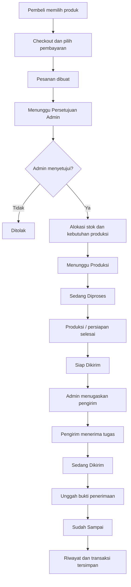

# PRD — Kulit Lumpia

> Product Requirements Document  
> Versi: 1.0  
> Status: Draft spesifikasi produk  
> Platform: Android  
> Bahasa aplikasi: Bahasa Indonesia  
> Backend dan database: Supabase

---

## 1. Ringkasan Produk

**Kulit Lumpia** adalah aplikasi mobile Android untuk mendukung proses penjualan dan operasional bisnis kulit lumpia. Aplikasi menghubungkan pembeli, admin, kepala karyawan, dan pengirim dalam satu alur kerja yang terintegrasi.

Aplikasi tidak hanya menangani transaksi pembelian, tetapi juga persetujuan pesanan, pembayaran, persiapan/produksi barang, penugasan pengiriman, konfirmasi penerimaan, notifikasi, dan riwayat aktivitas.

### 1.1 Tujuan

1. Memudahkan pembeli melihat produk dan melakukan pemesanan.
2. Memusatkan pesanan yang masuk agar dapat ditinjau admin.
3. Memberikan antrean kerja yang jelas kepada kepala karyawan.
4. Memastikan pengirim hanya melihat tugas yang ditugaskan kepadanya.
5. Memberikan informasi status pesanan yang transparan kepada pembeli.
6. Menyimpan catatan transaksi dan perubahan status secara konsisten.
7. Mengurangi kesalahan pencatatan pesanan, jumlah barang, pembayaran, dan pengiriman.

### 1.2 Sasaran Pengguna

| Pengguna | Kebutuhan utama |
|---|---|
| Pembeli | Memesan produk, membayar, dan memantau pesanan |
| Admin | Mengelola pesanan, pembayaran, produk, pengguna, dan pengiriman |
| Kepala Karyawan | Melihat antrean dan menyelesaikan persiapan/produksi pesanan |
| Pengirim | Melihat tugas pengiriman dan mengonfirmasi serah terima |

Semua role wajib login. Akses fitur dan data dibatasi berdasarkan role.

---

## 2. Keputusan Produk yang Sudah Ditetapkan

Keputusan berikut menjadi baseline pengembangan:

| Area | Keputusan |
|---|---|
| Platform | Android |
| Framework | Flutter |
| Backend/database | Supabase |
| Jenis produk | Produk memiliki varian dengan Generic Variant Structure (`products` 1-to-many `product_variants`). Atribut: `id`, `product_id`, `name`, `sku`, `price_per_piece`, `is_active`. |
| Satuan harga | Harga per lembar disimpan sebagai integer/bigint Rupiah |
| Minimum pesanan | 10 lembar |
| Kelipatan jumlah | 10 lembar |
| Pembayaran | Campuran: transfer dan COD; payment gateway belum ada di MVP |
| Bukti transfer | Wajib diunggah saat checkout untuk pembayaran transfer; tidak ada timeout auto-cancel pada MVP |
| Verifikasi transfer | Dilakukan manual oleh admin |
| COD | Konfirmasi 2 tahap: (1) Kurir lapor uang diterima fisik, (2) Admin verifikasi setoran uang kurir -> status `cod_collected` |
| Ongkos kirim | Gratis (Rp0) |
| Penugasan pengirim | Admin memilih/menugaskan pengirim aktif |
| Akses akun | Registrasi publik HANYA untuk role `buyer`. Akun staf (`admin`, `production_lead`, `courier`) dibuat tertutup oleh admin. Form registrasi publik tanpa pilihan role. Default role database adalah `buyer`. |
| Ketersediaan barang | Hybrid: stok tersedia dan kebutuhan produksi |
| Nomor pesanan | `ORD-YYYYMMDD-XXXX` |
| Bukti penerimaan | Wajib foto bukti penerimaan dan nama penerima; catatan tambahan opsional |
| Alamat | Alamat lengkap rumah; koordinat GPS tidak diwajibkan |

### 2.1 Aturan Kuantitas dan Harga

- Harga produk disimpan sebagai harga per lembar.
- Pembeli wajib memesan minimal 10 lembar.
- Jumlah pesanan harus kelipatan 10 lembar.
- Contoh jumlah valid: 10, 20, 30, 100, 1.000 lembar.
- Contoh jumlah tidak valid: 1, 15, 25 lembar.
- Total harga barang = jumlah lembar × harga per lembar.
- Ongkos kirim = Rp0 berdasarkan kebijakan saat ini.
- Total pembayaran = subtotal produk + ongkos kirim - diskon (jika fitur diskon kelak diaktifkan).
- Harga produk harus disalin ke detail item pesanan sebagai **price snapshot**. Perubahan harga katalog tidak boleh mengubah nilai pesanan lama.

Contoh: pembeli memesan 1.000 lembar dengan harga Rp1.000 per lembar, maka subtotal adalah Rp1.000.000.

---

## 3. Ruang Lingkup Produk

### 3.1 Fitur dalam MVP

1. Autentikasi dan profil pengguna.
2. Hak akses berbasis role.
3. Katalog produk dan varian.
4. Keranjang dan checkout.
5. Pembuatan nomor pesanan.
6. Pembayaran transfer manual dan COD.
7. Unggah bukti transfer.
8. Persetujuan atau penolakan pesanan oleh admin.
9. Antrean kerja kepala karyawan.
10. Pembaruan status persiapan/produksi.
11. Penugasan pengirim oleh admin.
12. Pembaruan status pengiriman.
13. Bukti serah terima/penerimaan.
14. Riwayat pesanan dan timeline status.
15. Notifikasi dalam aplikasi.
16. Dashboard ringkas sesuai role.
17. Audit log untuk tindakan penting.

### 3.2 Di Luar MVP

Fitur berikut tidak menjadi syarat rilis pertama:

- Pelacakan GPS pengirim secara langsung.
- Peta dan optimasi rute.
- Payment gateway otomatis sebelum provider dipilih dan integrasi diselesaikan.
- Program loyalitas dan poin.
- Voucher/diskon kompleks.
- Multi-cabang dan multi-gudang.
- Chat langsung antara pembeli dan pengirim.
- Website publik.

Fitur di luar MVP dapat dipertimbangkan setelah proses utama stabil.

---

## 4. Role dan Hak Akses

### 4.1 Pembeli

Pembeli dapat:
- Registrasi dan login.
- Melihat dan mencari produk.
- Melihat detail produk, varian, harga per lembar, dan ketersediaan.
- Menambah produk ke keranjang.
- Mengubah kuantitas sesuai aturan minimum dan kelipatan.
- Checkout dengan alamat lengkap.
- Memilih transfer atau COD.
- Mengunggah bukti transfer saat checkout jika memilih transfer.
- Melihat status pesanan dan pembayaran.
- Melihat riwayat pesanan.
- Membatalkan pesanan secara mandiri HANYA saat status `pending_approval`. Setelah disetujui admin, pembeli tidak dapat membatalkan sendiri (harus menghubungi admin).
- Melihat notifikasi.
- Mengubah profil dan alamat.

Pembeli tidak dapat:
- Menyetujui pesanan sendiri.
- Mengubah harga.
- Mengubah status produksi atau pengiriman.
- Melihat pesanan milik pembeli lain.
- Membatalkan pesanan setelah pesanan disetujui admin.

### 4.2 Admin

Admin dapat:
- Melihat dashboard dan seluruh pesanan.
- Melihat detail pesanan, item, jumlah, alamat, metode pembayaran, dan bukti transfer.
- Menyetujui atau menolak pesanan dengan alasan.
- Memverifikasi atau menolak bukti transfer manual.
- Mengelola produk, varian, harga, dan status ketersediaan.
- Mengelola akun dan role staf (`admin`, `production_lead`, `courier`) secara tertutup.
- Menugaskan pengirim.
- Mengganti pengirim sebelum pengiriman dimulai, dengan alasan dan audit log.
- Membatalkan pesanan setelah persetujuan jika diperlukan, dengan alasan wajib serta memicu proses karantina/pemeriksaan kelayakan sisa produksi.
- Memproses refund pembayaran transfer secara manual melalui transfer bank dan mencatat rincian transaksi refund di aplikasi.
- Melihat riwayat aktivitas dan laporan.
- Mengonfirmasi pembayaran COD (tahap kedua) setelah menerima dan memverifikasi setoran uang fisik dari pengirim, mengubah status pembayaran menjadi `cod_collected`.

Admin tidak boleh mengubah catatan transaksi lama secara diam-diam. Perubahan penting harus tercatat di audit log.

### 4.3 Kepala Karyawan

Kepala karyawan dapat:
- Melihat pesanan yang sudah disetujui dan diteruskan ke proses kerja.
- Melihat item, varian, jumlah, dan catatan pesanan.
- Melihat antrean pekerjaan.
- Mengubah status menjadi sedang diproses ketika pekerjaan benar-benar dimulai.
- Menandai pekerjaan/produksi selesai (mengubah status ke `ready_for_delivery`).
- Menambahkan catatan kendala.
- Melakukan pemeriksaan kelayakan barang sisa produksi pesanan batal bersama admin (proses karantina).
- Melihat riwayat pekerjaan yang ditangani.

Kepala karyawan tidak dapat:
- Mengubah harga atau pembayaran.
- Menolak pesanan yang telah disetujui admin.
- Menugaskan pengirim.
- Mengubah status pengiriman.

### 4.4 Pengirim

Pengirim dapat:
- Melihat daftar tugas yang ditugaskan kepadanya.
- Melihat detail pesanan dan alamat penerima.
- Mengonfirmasi bahwa barang telah diambil untuk dikirim.
- Mengubah status menjadi sedang dikirim (`in_delivery`).
- Melaporkan penerimaan uang fisik untuk pesanan COD (tahap pertama konfirmasi COD).
- Mengunggah foto bukti penerimaan dan menginput nama penerima (catatan opsional). Keduanya wajib sebelum konfirmasi `delivered`.
- Menandai pesanan sudah sampai (`delivered`).
- Menambahkan catatan jika penerima tidak ditemukan atau pengiriman bermasalah.

Pengirim tidak dapat:
- Melihat tugas pengirim lain.
- Mengubah jumlah dan harga pesanan.
- Mengubah status produksi.
- Menyatakan pembayaran transfer lunas.
- Menetapkan pembayaran COD menjadi lunas (`cod_collected`); pengirim hanya melaporkan penerimaan uang fisik, penetapan lunas tetap kewenangan verifikasi admin.

---

## 5. Alur Bisnis Utama

### 5.1 Alur End-to-End

1. **Pembeli memilih produk**
   - Pembeli membuka katalog.
   - Memilih produk dan varian.
   - Memasukkan kuantitas.
   - Sistem memvalidasi minimal 10 lembar dan kelipatan 10.
   - Sistem menghitung subtotal berdasarkan harga aktif.

2. **Pembeli checkout**
   - Pembeli memilih atau mengisi alamat lengkap rumah.
   - Pembeli memilih metode pembayaran: transfer atau COD.
   - Jika transfer, pembeli mengunggah bukti transfer saat checkout.
   - Jika COD, pesanan dicatat sebagai COD belum diterima.
   - Sistem membuat pesanan dan nomor unik `ORD-YYYYMMDD-XXXX`.
   - Sistem menyimpan snapshot nama produk, varian, harga, kuantitas, alamat, dan total.

3. **Admin meninjau pesanan**
   - Pesanan muncul pada antrean admin dengan status `Menunggu Persetujuan`.
   - Admin memeriksa detail pesanan.
   - Untuk transfer, admin memeriksa bukti dan nominal transfer.
   - Admin dapat menyetujui atau menolak pesanan.
   - Penolakan wajib disertai alasan.
   - Persetujuan memicu alokasi stok tersedia dan/atau kebutuhan produksi secara atomik.

4. **Pesanan masuk ke kepala karyawan**
   - Setelah disetujui, pesanan tersedia pada antrean kepala karyawan.
   - Status operasional menjadi `Menunggu Produksi`.
   - Ketika pekerjaan dimulai, kepala karyawan menekan tombol mulai dan status menjadi `Sedang Diproses`.

5. **Pekerjaan/produksi diselesaikan**
   - Kepala karyawan memeriksa kuantitas dan varian yang harus disiapkan.
   - Jika seluruh barang siap, kepala karyawan menekan `Selesaikan Produksi`.
   - Status berubah menjadi `Siap Dikirim`.
   - Sistem membuat tugas penugasan pengiriman untuk admin.
   - Jika ada kekurangan atau kendala, kepala karyawan menambahkan catatan dan tidak boleh menandai selesai sebelum jumlah siap dikonfirmasi.

6. **Admin menugaskan pengirim**
   - Admin melihat antrean `Siap Dikirim`.
   - Admin memilih pengirim aktif.
   - Sistem mencatat siapa yang menugaskan, kapan, dan kepada siapa.
   - Pesanan muncul pada akun pengirim yang dipilih.
   - Sebelum ditugaskan, status operasional tetap `Siap Dikirim`.
   - Setelah admin memilih pengirim, status berubah menjadi `Ditugaskan ke Pengirim`.

7. **Pengirim mengambil dan mengirim barang**
   - Pengirim memeriksa barang dan alamat.
   - Pengirim menekan `Mulai Pengiriman`.
   - Status berubah menjadi `Sedang Dikirim`.
   - Waktu mulai dan identitas pengirim dicatat.

8. **Pesanan diterima**
   - Pengirim menyerahkan barang kepada penerima.
   - Pengirim mengunggah bukti penerimaan/serah terima.
   - Pengirim menekan `Konfirmasi Sudah Sampai`.
   - Status berubah menjadi `Sudah Sampai`.
   - Sistem menyimpan waktu, pengirim, dan bukti.
   - Pembeli menerima notifikasi bahwa barang telah sampai.

9. **Transaksi ditutup**
   - Untuk transfer yang sudah diverifikasi, status pembayaran tetap `Lunas`.
   - Untuk COD, admin mencatat penerimaan uang setelah benar-benar diterima. Pengiriman sampai tidak otomatis berarti pembayaran COD lunas.
   - Pesanan dianggap selesai secara operasional ketika sudah sampai; status pembayaran tetap dilacak terpisah.
   - Sistem menyimpan seluruh riwayat.

### 5.2 Diagram Alur

### 5.3 Status Pesanan

Status pesanan dan status pembayaran wajib dipisahkan.

| Status pesanan | Arti |
|---|---|
| `pending_approval` | Menunggu persetujuan admin |
| `rejected` | Ditolak admin |
| `awaiting_production` | Disetujui dan menunggu proses |
| `in_production` | Sedang diproses kepala karyawan |
| `ready_for_delivery` | Barang sudah siap dikirim |
| `assigned_to_courier` | Pengirim sudah ditugaskan; sebelumnya pesanan berada pada status `ready_for_delivery` |
| `in_delivery` | Sedang dikirim |
| `delivered` | Barang sudah sampai |
| `cancelled` | Dibatalkan |

Label UI menggunakan Bahasa Indonesia. Nilai internal menggunakan enum/string stabil seperti di atas.

**Catatan:** Gunakan `ready_for_delivery` selama barang menunggu penugasan, lalu `assigned_to_courier` setelah admin menetapkan pengirim. Jangan menambahkan status menunggu pengirim yang redundan. Jangan menggunakan label `Pesanan Selesai` untuk kondisi barang baru selesai diproduksi.

### 5.4 Status Pembayaran

| Status pembayaran | Arti |
|---|---|
| `unpaid` | Belum ada pembayaran yang diterima |
| `proof_submitted` | Bukti transfer diunggah dan menunggu pemeriksaan |
| `paid` | Pembayaran telah diverifikasi/diterima |
| `payment_rejected` | Bukti pembayaran ditolak |
| `cod_pending` | COD belum diterima |
| `cod_collected` | Uang COD telah diterima dan dicatat |
| `refunded` | Dana telah dikembalikan, jika proses refund diterapkan |

Metode pembayaran disimpan terpisah, misalnya `bank_transfer`, `cod`, atau metode gateway ketika integrasi tersedia.

---

## 6. Aturan Pembayaran

### 6.1 Transfer Manual

1. Pembeli memilih metode transfer bank.
2. Aplikasi menampilkan instruksi rekening resmi.
3. Pembeli wajib mengunggah foto bukti transfer saat checkout; tanpa bukti transfer, pesanan tidak dapat dibuat.
4. Pesanan dan bukti masuk ke antrean verifikasi admin dengan status pembayaran `proof_submitted`.
5. Tidak ada batas waktu (timeout) pembatalan otomatis (auto-cancel) pada MVP. Verifikasi dilakukan manual oleh admin.
6. Admin memeriksa kesesuaian bukti, nominal, dan nomor referensi transaksi rekening.
7. Admin menyetujui atau menolak bukti. Jika bukti tidak valid, admin menolak pesanan dengan mencatat alasan penolakan secara wajib.
8. Status pembayaran berubah menjadi `paid` atau `payment_rejected`.
9. Bukti dan log verifikasi tersimpan aman di bucket privat.

**Penting:**
- Mengunggah gambar bukti transfer tidak otomatis membuat pembayaran lunas.
- **Kebijakan Refund Transfer (D-03):** Jika pesanan transfer dibatalkan atau ditolak setelah dana masuk, pengembalian dana (refund) dilakukan secara manual oleh admin melalui transfer bank. Sistem wajib menyediakan pencatatan: (a) nominal refund, (b) tanggal refund, (c) referensi transaksi refund, (d) catatan refund, dan (e) bukti transfer refund jika tersedia. Status pembayaran hanya boleh berubah menjadi `refunded` setelah transfer pengembalian benar-benar dilakukan dan dicatat oleh admin. Status pembayaran tidak boleh otomatis berubah menjadi `refunded` hanya karena pesanan dibatalkan.

### 6.2 COD (Cash on Delivery)

1. Pembeli memilih metode COD saat checkout.
2. Pesanan dibuat dengan status pembayaran `cod_pending`.
3. Pesanan mengikuti alur persetujuan admin, antrean produksi, dan penugasan pengiriman.
4. Konfirmasi penerimaan pembayaran COD dilakukan secara **2 tahap**:
   - **Tahap Pertama (Kurir):** Kurir menyerahkan pesanan kepada pembeli dan melaporkan apakah uang tunai COD sudah diterima di lapangan. Kurir tidak berwenang menetapkan pembayaran sebagai lunas.
   - **Tahap Kedua (Admin):** Admin memverifikasi fisik setoran uang COD yang diserahkan kurir. Setelah uang diverifikasi diterima oleh admin, status pembayaran berubah menjadi `cod_collected`.
5. Status pengiriman (`delivered`) dan status pembayaran (`cod_collected`) dipisahkan secara tegas. Barang telah sampai tidak otomatis berarti pembayaran COD lunas.

### 6.3 Payment Gateway

Payment gateway belum menjadi bagian wajib MVP. Jika ditambahkan, callback/webhook harus diverifikasi server-side. Jangan mempercayai status pembayaran yang dikirim langsung dari aplikasi klien.

---

## 7. Produk, Stok, dan Produksi

### 7.1 Produk dan Varian

Produk menggunakan model varian dengan **Generic Variant Structure** (D-04). Relasi data: `products` 1-to-many `product_variants`. Setiap varian memiliki harga per lembar dan status aktif sendiri.

Atribut minimum varian:
- `id` (UUID)
- `product_id` (UUID foreign key ke `products`)
- `name` (String, dapat memuat kombinasi ukuran dan jenis produk, misal: "Kulit Lumpia 18cm Basah" atau "Kulit Lumpia 20cm Krispi")
- `sku` (String opsional)
- `price_per_piece` (Integer/bigint Rupiah, bukan floating point)
- `is_active` (Boolean status ketersediaan)

**Aturan Struktur:** Jangan membuat kolom varian yang terlalu spesifik seperti `diameter_cm`, `thickness`, atau `type` sebagai struktur wajib database. Pendekatan generic ini menjaga fleksibilitas katalog jika jenis produk berkembang di masa depan.

Data produk minimal:
- Nama produk.
- Deskripsi.
- Foto produk (disimpan di bucket publik `product-images`).
- Daftar varian aktif.
- Status aktif/nonaktif.
- Informasi ketersediaan.

### 7.2 Ketersediaan Hybrid

Ketersediaan menggunakan gabungan stok siap jual dan kebutuhan produksi.

Konsep awal:
- `on_hand`: stok fisik tersedia.
- `reserved`: stok yang sudah dialokasikan ke pesanan yang disetujui tetapi belum dikeluarkan.
- `available`: `on_hand - reserved`.
- `production_required`: jumlah yang belum dapat dipenuhi dari stok tersedia.

Saat admin menyetujui pesanan, sistem menghitung alokasi stok dan kebutuhan produksi dalam satu transaksi database agar dua pesanan bersamaan tidak memakai stok yang sama.

### 7.3 Penanganan Sisa Produksi Pesanan Batal (D-01)

Barang yang sudah diproduksi ketika pesanan dibatalkan tidak boleh otomatis masuk stok siap jual.

Alur penanganan sisa produksi:
1. Admin membatalkan pesanan yang sudah berstatus `in_production` atau `ready_for_delivery`.
2. Sisa barang hasil produksi masuk ke proses karantina/pemeriksaan kelayakan fisik.
3. Admin atau kepala karyawan melakukan pemeriksaan kelayakan fisik barang.
4. Jika layak jual, barang dikembalikan ke stok tersedia (`inventory.on_hand += quantity`).
5. Jika tidak layak jual, barang dicatat sebagai *waste*/kerugian produksi.
6. Seluruh mutasi barang dan keputusan wajib memiliki catatan audit log lengkap.

---

## 8. Pembatalan dan Penolakan

### 8.1 Penolakan Admin

- Hanya admin yang dapat menolak pesanan yang menunggu persetujuan (`pending_approval`).
- Alasan penolakan wajib diisi dan dicatat di database.
- Pembeli menerima notifikasi penolakan beserta alasannya.
- Jika bukti transfer sudah diunggah dan diverifikasi, admin wajib mengikuti prosedur pencatatan refund manual jika dana benar-benar telah diterima.

### 8.2 Pembatalan Pesanan (D-02 & D-03)

- **Pembatalan Mandiri oleh Pembeli (D-02):** Pembeli HANYA boleh membatalkan pesanan secara mandiri saat status pesanan masih `pending_approval`. Begitu pesanan disetujui admin, tombol pembatalan mandiri di aplikasi pembeli tidak lagi tersedia. Jika ingin membatalkan, pembeli harus menghubungi admin toko.
- **Pembatalan oleh Admin:** Admin memiliki kewenangan membatalkan pesanan setelah persetujuan sesuai aturan bisnis, dengan alasan pembatalan wajib dicatat.
- **Dampak Pembatalan terhadap Stok:**
  - Jika produksi belum dimulai, alokasi stok yang belum dipakai segera dilepas (`reserved` dikurangi).
  - Jika produksi sudah berjalan (`in_production`) atau selesai (`ready_for_delivery`), sisa barang produksi diarahkan ke alur karantina/pemeriksaan kelayakan fisik (D-01).
- Jika pesanan sudah masuk tahap pengiriman (`in_delivery`) atau sudah sampai (`delivered`), pembatalan normal tidak diperbolehkan.
- Pembatalan tidak boleh menghapus data pesanan maupun riwayat pembayaran fisik.
- **Pencatatan Refund Transfer (D-03):** Pengembalian dana dilakukan manual oleh admin melalui transfer bank. Sistem mencatat: (a) nominal refund, (b) tanggal refund, (c) referensi transaksi refund, (d) catatan refund, dan (e) bukti transfer refund jika tersedia. Status pembayaran hanya boleh menjadi `refunded` setelah transfer pengembalian dicatat di sistem; status refund tidak otomatis selesai hanya karena pesanan dibatalkan.

---

## 9. Alamat dan Pengiriman

Alamat wajib memuat:
- Nama penerima.
- Nomor telepon penerima.
- Alamat lengkap rumah.
- Detail tambahan/patokan (opsional).
- Kecamatan.
- Kota/kabupaten.
- Provinsi.
- Kode pos (opsional jika tidak tersedia).

Koordinat GPS tidak wajib untuk MVP.

Aturan pengiriman:
- Ongkos kirim gratis sesuai keputusan saat ini.
- Admin memilih pengirim dari daftar pengirim aktif.
- Satu tugas pengiriman memiliki satu pengirim penanggung jawab pada satu waktu.
- Penggantian pengirim sebelum pengiriman dimulai harus dicatat.
- Pengirim hanya dapat memperbarui pesanan yang ditugaskan kepadanya.
- **Bukti Pengiriman/Penerimaan (D-06):** Bukti pengiriman wajib terdiri dari:
  1. Foto bukti penerimaan (wajib).
  2. Nama penerima barang (wajib).
  3. Catatan tambahan (opsional).
  Kurir tidak dapat menyelesaikan pengiriman (`delivered`) sebelum foto dan nama penerima tersedia.
- Jika penerima tidak ditemukan, pengirim tidak boleh menandai pesanan sudah sampai. Pengirim menambahkan catatan kendala dan admin menindaklanjuti.

---

## 10. Notifikasi

Notifikasi dalam aplikasi diperlukan untuk kejadian berikut:

| Penerima | Pemicu |
|---|---|
| Pembeli | Pesanan berhasil dibuat |
| Admin | Pesanan baru masuk |
| Pembeli | Pesanan disetujui atau ditolak |
| Kepala Karyawan | Pesanan baru masuk antrean |
| Admin | Produksi selesai dan pesanan siap ditugaskan |
| Pengirim | Tugas pengiriman baru diberikan |
| Pembeli | Pesanan mulai dikirim |
| Pembeli | Pesanan sudah sampai |
| Admin | Bukti transfer baru atau pembayaran perlu diverifikasi |
| Admin | Pembayaran COD perlu dicatat |

Realtime dapat digunakan untuk memperbarui layar saat data berubah. Push notification dapat ditambahkan untuk pemberitahuan ketika aplikasi tidak sedang terbuka.

---

## 11. Layar Aplikasi

### 11.1 Layar Umum

- Splash screen.
- Login.
- Registrasi.
- Lupa kata sandi.
- Profil.
- Notifikasi.
- Pengaturan akun.

### 11.2 Layar Pembeli

- Beranda.
- Katalog produk.
- Detail produk dan varian.
- Keranjang.
- Checkout.
- Instruksi pembayaran.
- Unggah bukti transfer.
- Daftar pesanan.
- Detail pesanan dan timeline.
- Riwayat pesanan.
- Daftar alamat.

### 11.3 Layar Admin

- Dashboard admin.
- Daftar pesanan masuk.
- Detail dan review pesanan.
- Verifikasi bukti transfer.
- Manajemen produk.
- Manajemen varian dan harga.
- Manajemen stok.
- Penugasan pengirim.
- Manajemen pengguna.
- Riwayat transaksi.
- Laporan.
- Audit log.

### 11.4 Layar Kepala Karyawan

- Dashboard pekerjaan.
- Antrean pesanan.
- Detail pekerjaan.
- Mulai proses.
- Catatan kendala.
- Konfirmasi pekerjaan selesai.
- Riwayat pekerjaan.

### 11.5 Layar Pengirim

- Dashboard pengiriman.
- Tugas baru.
- Detail pengiriman.
- Mulai pengiriman.
- Konfirmasi sampai.
- Unggah bukti penerimaan.
- Riwayat pengiriman.

---

## 12. Kebutuhan Data Utama

Rancangan tabel konseptual (nama dapat disesuaikan saat desain database):

| Tabel | Fungsi |
|---|---|
| `profiles` | Profil pengguna dan role |
| `addresses` | Alamat pembeli |
| `products` | Data produk |
| `product_variants` | Varian produk |
| `inventory` | Stok fisik dan stok tersedia |
| `inventory_movements` | Riwayat perubahan stok |
| `orders` | Header pesanan |
| `order_items` | Item pesanan dan snapshot harga |
| `order_status_history` | Riwayat status pesanan |
| `payments` | Data pembayaran |
| `payment_verifications` | Hasil verifikasi pembayaran |
| `delivery_assignments` | Penugasan pengirim |
| `delivery_proofs` | Bukti serah terima |
| `notifications` | Notifikasi aplikasi |
| `activity_logs` | Audit tindakan penting |

### 12.1 Prinsip Data

- Gunakan UUID sebagai primary key.
- Gunakan `timestamptz` untuk waktu.
- Simpan nominal uang sebagai integer/bigint rupiah, bukan floating point.
- Simpan snapshot harga dan alamat di transaksi.
- Gunakan foreign key dan constraint.
- Gunakan transaksi database untuk operasi yang harus atomik.
- Jangan menghapus transaksi penting secara fisik; gunakan status dan audit trail.
- Nomor pesanan harus unik dan dibuat server-side.
- Simpan histori status sebagai data append-only yang terhubung dengan pesanan.

---

## 13. Aturan Keamanan dan Integritas

1. Aktifkan Row Level Security (RLS) pada seluruh tabel yang terekspos ke aplikasi.
2. Pembeli hanya dapat membaca pesanan, alamat, dan pembayaran miliknya.
3. Kepala karyawan hanya dapat mengakses pekerjaan yang menjadi kewenangannya.
4. Pengirim hanya dapat membaca dan memperbarui tugas yang ditugaskan kepadanya.
5. Admin memiliki akses sesuai role dan kebijakan organisasi.
6. Role tidak boleh dapat diubah sendiri oleh pengguna.
7. Jangan pernah menaruh Supabase `service_role` key di aplikasi Flutter.
8. Validasi transisi status di database/RPC atau Edge Functions.
9. Upload file menggunakan bucket privat dan signed URL bila diperlukan.
10. Batasi jenis dan ukuran file bukti transfer serta bukti pengiriman.
11. Semua aksi persetujuan, penolakan, pembatalan, verifikasi pembayaran, penugasan, dan penyelesaian harus tercatat.
12. Hindari update status langsung tanpa memeriksa status sebelumnya dan role pelaku.
13. Operasi stok harus aman dari race condition dan double allocation.
14. Jangan menyimpan password dalam tabel profil.

---

## 14. Kebutuhan Non-Fungsional

### 14.1 Performa
- Halaman utama dan daftar pesanan menggunakan pagination.
- Gambar produk dikompresi dan di-cache.
- Query menggunakan indeks yang sesuai.
- Realtime hanya berlangganan pada channel dan data yang diperlukan.

### 14.2 Keandalan
- Operasi penting harus aman terhadap permintaan ganda (idempotent).
- Jika koneksi terputus, aplikasi menampilkan kondisi gagal dan menyediakan retry yang aman.
- Status tidak boleh berubah ganda akibat tombol ditekan berulang.
- Kegagalan upload bukti harus dapat diketahui pengguna.

### 14.3 Kompatibilitas
- Fokus Android.
- UI responsif untuk berbagai ukuran layar.
- Menangani izin internet dan akses kamera/galeri sesuai kebutuhan.
- Aplikasi membutuhkan koneksi internet untuk sinkronisasi dengan Supabase.

### 14.4 Aksesibilitas dan UX
- Gunakan Bahasa Indonesia yang jelas.
- Status menggunakan teks, bukan warna saja.
- Tombol aksi penting memiliki konfirmasi.
- Form menampilkan validasi dekat dengan input.
- Tampilkan loading, empty state, error state, dan success state.

---

## 15. Kriteria Penerimaan MVP

### Autentikasi dan Role
- [ ] Pengguna dapat login dan logout.
- [ ] Pengguna hanya melihat menu sesuai role.
- [ ] Pengguna tidak dapat mengakses data role lain melalui manipulasi aplikasi/API.

### Pemesanan
- [ ] Pembeli dapat memilih produk dan varian.
- [ ] Kuantitas di bawah 10 ditolak.
- [ ] Kuantitas bukan kelipatan 10 ditolak.
- [ ] Harga dan total dihitung konsisten di server.
- [ ] Nomor pesanan unik dengan format `ORD-YYYYMMDD-XXXX`.
- [ ] Snapshot harga dan alamat tersimpan.

### Admin
- [ ] Admin dapat melihat pesanan baru.
- [ ] Admin dapat menyetujui atau menolak dengan alasan.
- [ ] Admin dapat memverifikasi bukti transfer.
- [ ] Admin dapat menugaskan pengirim.
- [ ] Admin dapat membatalkan pesanan dengan alasan dan audit log.

### Kepala Karyawan
- [ ] Kepala karyawan melihat pesanan yang disetujui.
- [ ] Kepala karyawan dapat memulai dan menyelesaikan proses.
- [ ] Penyelesaian menghasilkan status siap dikirim.

### Pengiriman
- [ ] Pengirim hanya melihat tugas miliknya.
- [ ] Pengirim dapat memulai pengiriman.
- [ ] Pengirim wajib mengunggah bukti penerimaan.
- [ ] Status menjadi sudah sampai setelah konfirmasi valid.

### Pembayaran
- [ ] Transfer memerlukan bukti saat checkout.
- [ ] Bukti transfer tidak otomatis dianggap lunas.
- [ ] COD tidak otomatis lunas ketika barang sampai.
- [ ] Admin dapat mencatat penerimaan COD.

### Sistem
- [ ] Perubahan status tersimpan dalam histori.
- [ ] Notifikasi muncul untuk kejadian penting.
- [ ] RLS diuji untuk seluruh role.
- [ ] Operasi stok diuji untuk pesanan bersamaan.
- [ ] Audit log mencatat tindakan sensitif.

---

## 16. Risiko dan Mitigasi

| Risiko | Mitigasi |
|---|---|
| Dua pesanan memakai stok yang sama | Alokasi stok atomik di database |
| Pembeli memanipulasi harga | Hitung ulang harga di server |
| Bukti transfer palsu | Verifikasi manual admin |
| Status diubah role yang salah | RLS dan validasi RPC |
| Pengirim melihat pesanan orang lain | Policy berdasarkan assignment |
| Produksi selesai tetapi belum ada pengirim | Antrean penugasan admin |
| Pesanan dibatalkan setelah produksi | Catat hasil produksi dan keputusan stok |
| Tombol diklik berkali-kali | Idempotency dan validasi transisi |
| Koneksi internet terputus | Error handling dan retry aman |

---

## 17. Tahapan Implementasi

### Tahap 0 — Fondasi
- Finalisasi aturan bisnis yang masih terbuka.
- Setup Flutter dan Supabase.
- Setup environment development.
- Desain schema, role, RLS, dan storage.
- Seed akun dan data pengujian.

### Tahap 1 — Autentikasi dan Master Data
- Login/register.
- Profil dan role.
- Produk dan varian.
- Alamat pembeli.

### Tahap 2 — Pemesanan dan Pembayaran
- Katalog.
- Keranjang.
- Checkout.
- Nomor pesanan.
- Upload bukti transfer.
- Admin review dan verifikasi.

### Tahap 3 — Produksi
- Antrean kepala karyawan.
- Mulai proses.
- Selesaikan produksi.
- Histori status.

### Tahap 4 — Pengiriman
- Penugasan pengirim.
- Daftar tugas pengirim.
- Mulai pengiriman.
- Bukti penerimaan.
- Konfirmasi sampai.

### Tahap 5 — Notifikasi dan Laporan
- Realtime.
- Notifikasi in-app.
- Push notification jika diperlukan.
- Dashboard dan laporan dasar.

### Tahap 6 — Pengujian dan Rilis
- Unit test.
- Widget test.
- Integration test.
- Uji RLS per role.
- Uji transaksi dan stok bersamaan.
- Build APK release.
- UAT dan rilis.

---

## 18. Keputusan Bisnis Resmi yang Telah Dikunci (Stage 0.2 Locked)

Seluruh keputusan bisnis berikut telah disetujui resmi oleh Product Owner dan terkunci sebagai acuan implementasi:

1. **D-01 — Penanganan Sisa Produksi Pesanan Batal:**
   Barang yang sudah diproduksi ketika pesanan dibatalkan tidak boleh otomatis masuk stok siap jual. Sisa barang produksi masuk proses karantina/pemeriksaan kelayakan oleh Admin atau Kepala Karyawan. Jika layak jual, barang dikembalikan ke stok tersedia (`inventory.on_hand += qty`). Jika tidak layak jual, dicatat sebagai *waste*/kerugian. Seluruh mutasi dicatat dalam audit log.
2. **D-02 — Pembatalan Mandiri Pembeli:**
   Pembeli HANYA boleh membatalkan pesanan secara mandiri saat status pesanan masih `pending_approval`. Setelah admin menyetujui pesanan, pembeli tidak dapat membatalkan sendiri via aplikasi (harus menghubungi admin). Admin memiliki kewenangan membatalkan pesanan setelah persetujuan sesuai aturan bisnis.
3. **D-03 — Refund Transfer:**
   Refund dilakukan secara manual oleh admin melalui transfer bank. Sistem wajib menyediakan pencatatan: (a) nominal refund, (b) tanggal refund, (c) referensi transaksi refund, (d) catatan refund, dan (e) bukti transfer refund jika tersedia. Status pembayaran hanya boleh menjadi `refunded` setelah transfer pengembalian benar-benar dilakukan dan dicatat oleh admin. Pembatalan pesanan tidak otomatis mengubah status menjadi `refunded`.
4. **D-04 — Struktur Varian Produk:**
   Menggunakan Generic Variant Structure (`products` 1-to-many `product_variants`). Atribut minimum: `id`, `product_id`, `name` (memuat kombinasi ukuran dan jenis), `sku`, `price_per_piece` (integer/bigint Rupiah), dan `is_active`. Tidak membuat kolom spesifik seperti `diameter_cm`, `thickness`, atau `type` sebagai struktur wajib database.
5. **D-05 — Pembuatan Akun Staf:**
   Registrasi publik hanya diperbolehkan untuk role `buyer`. Akun staf (`admin`, `production_lead`, `courier`) dibuat secara tertutup oleh admin melalui mekanisme administratif yang aman. Formulir registrasi publik tidak menyediakan pilihan role. Role default pengguna baru ditetapkan server-side/database-side sebagai `buyer`.
6. **D-06 — Bukti Pengiriman/Penerimaan:**
   Bukti pengiriman wajib terdiri dari foto bukti penerimaan dan nama penerima barang (catatan tambahan opsional). Kurir tidak dapat menyelesaikan pengiriman (`delivered`) sebelum foto dan nama penerima tersedia.
7. **D-07 — Batas Waktu Pembayaran & Verifikasi:**
   Bukti transfer wajib diunggah saat checkout. Tidak ada auto-cancel pembayaran berdasarkan timeout pada MVP. Admin melakukan verifikasi secara manual. Jika bukti tidak valid, admin menolak pesanan dengan alasan wajib dicatat. Ketentuan SLA operasional verifikasi belum ditetapkan angka finalnya dan tidak menggunakan timer pembatalan otomatis.
8. **Aturan COD Terkunci (2 Tahap):**
   Konfirmasi penerimaan COD dilakukan 2 tahap: (1) Kurir melaporkan penerimaan uang fisik di lapangan (tidak berwenang menyatakan lunas), (2) Admin memverifikasi setoran fisik dari kurir dan mengubah status pembayaran menjadi `cod_collected`. Status pengiriman dan pembayaran dipisahkan secara tegas.

---

## 19. Definisi Selesai (Definition of Done)

MVP dinyatakan siap digunakan ketika:
- Semua alur utama dari checkout sampai pesanan diterima berjalan.
- Setiap role hanya dapat melakukan tindakan yang diizinkan.
- Status pesanan dan pembayaran konsisten.
- Stok dan kebutuhan produksi tidak mengalami alokasi ganda.
- Bukti transfer dan bukti penerimaan tersimpan aman.
- Histori dan audit log tersedia.
- Pengujian alur kritis dan RLS lulus.
- Admin dan staf telah menjalani UAT.
