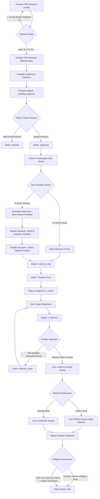

# DOKUMEN PERANCANGAN UX, INFORMATION ARCHITECTURE, DAN USER FLOW (UX_DESIGN.md)

**Aplikasi:** Kulit Lumpia (Android)  
**Versi Dokumen:** 1.0  
**Tanggal:** 2 November 2026  
**Status Dokumen:** Pedoman Perancangan UX Tahap 1  
**Target Platform:** Android (Flutter)  
**Backend:** Supabase (PostgreSQL, Auth, RLS, Storage)  

---

## 1. Ringkasan Eksekutif & Prinsip Desain

Dokumen ini merupakan cetak biru perancangan antarmuka pengguna (*User Experience / User Interface*), arsitektur informasi (*Information Architecture*), pemetaan navigasi, dan alur interaksi pengguna (*User Flow*) untuk aplikasi Android **Kulit Lumpia**.

### Prinsip Utama Desain (Sesuai `DESIGN.md` & `STYLEGUIDE.md`)
1. **Aplikasi Operasional Nyata**: Aplikasi difokuskan untuk efisiensi transaksi, produksi, dan logistik usaha fisik kulit lumpia; bukan aplikasi etalase dekoratif atau media sosial.
2. **Anti-AI-Slop**:
   - Menghindari gradien dekoratif tanpa makna, efek *glassmorphism*, bayangan berlebihan (*glow*), *blur*, dan elemen mengambang abstrak (*floating blobs*).
   - Menghindari tata letak kartu bertingkat yang membingungkan.
   - **Dilarang menggunakan emoji sebagai ikon antarmuka**. Gunakan ikon Material Design semantik.
3. **Bahasa Indonesia Baku & Alami**: Seluruh label antarmuka, dialog, status, dan pesan kesalahan menggunakan Bahasa Indonesia yang ringkas, sopan, dan jelas bagi operasional usaha.
4. **Kejelasan Hierarki & Aksesibilitas Android**:
   - Area sentuh minimal 48x48 dp untuk kemudahan interaksi di lingkungan dapur produksi atau saat kurir di perjalanan.
   - Kontras warna teks tinggi terhadap latar belakang permukaan.
   - Penanganan state lengkap: *Loading*, *Empty*, *Error*, *Success*, serta *Confirmation Dialog* sebelum tindakan krusial.
5. **Kebenaran Data Berada di Server**: Antarmuka client tidak pernah menjadi penentu harga, stok, atau validasi mutlak. UI mencerminkan status server dan memberikan respon interaktif yang jelas.

---

## 2. Information Architecture (IA) Berdasarkan Role

Aplikasi membagi hak akses ke dalam empat role utama: **Pembeli (`buyer`)**, **Admin (`admin`)**, **Kepala Karyawan / Produksi (`production`)**, dan **Kurir (`courier`)**.

```
Aplikasi Kulit Lumpia
│
├── Area Publik / Autentikasi
│   ├── Layar Masuk (Login)
│   ├── Layar Registrasi (Khusus Pembeli)
│   └── Layar Lupa Sandi
│
├── Area Pembeli (buyer)
│   ├── Navigasi Utama: Beranda & Katalog
│   │   ├── Daftar Produk & Variasi
│   │   └── Detail Produk & Pemilihan Jumlah (Min 10, Kelipatan 10)
│   ├── Keranjang & Checkout
│   │   ├── Ringkasan Keranjang
│   │   ├── Pengaturan / Pemilihan Alamat Pengiriman
│   │   └── Formulir Checkout & Pemilihan Pembayaran (Transfer/COD)
│   ├── Navigasi Utama: Pesanan Saya
│   │   ├── Tab Pesanan Aktif (Status Berjalan)
│   │   ├── Tab Riwayat Pesanan (Selesai/Dibatalkan/Ditolak)
│   │   ├── Detail Pesanan & Riwayat Status
│   │   └── Unggah Bukti Transfer Bank
│   └── Navigasi Utama: Profil
│       ├── Data Pribadi (Nama, No. Telepon)
│       ├── Daftar Buku Alamat
│       └── Tombol Keluar (Logout)
│
├── Area Admin (admin)
│   ├── Dashboard Ringkasan Operasional
│   ├── Kelola Pesanan (Order Management)
│   │   ├── Antrean Menunggu Persetujuan (pending_approval)
│   │   ├── Detail & Modal Aksi (Setujui / Tolak dengan Alasan)
│   │   └── Seluruh Daftar Pesanan & Filter Status
│   ├── Kelola Produk & Variasi
│   │   ├── Daftar Variasi Kulit Lumpia & Harga
│   │   └── Form Tambah/Ubah Variasi & Status Aktif
│   ├── Kelola Stok & Persediaan (Inventory)
│   │   ├── Monitoring Stok Fisik (On-Hand) & Cadangan (Reserved)
│   │   └── Penyesuaian Stok (Stock Adjustment) & Riwayat
│   ├── Verifikasi Pembayaran
│   │   ├── Antrean Verifikasi Transfer Bank (Tinjau Bukti Foto)
│   │   └── Rekapitulasi & Konfirmasi Setoran Tunai Kurir (COD)
│   ├── Kelola Pengiriman
│   │   ├── Antrean Siap Kirim (ready_to_ship)
│   │   └── Form Penetapan Kurir (Penugasan)
│   └── Laporan Operasional & Audit Trail
│
├── Area Kepala Karyawan / Produksi (production)
│   ├── Dashboard Produksi (Ringkasan Target Harian)
│   ├── Antrean Kebutuhan Produksi (Make-to-Order)
│   ├── Detail Batch Produksi Pesanan
│   │   ├── Rincian Variasi & Target Lembar
│   │   ├── Tombol Mulai Produksi
│   │   └── Form Catat Progres / Selesaikan Produksi
│   └── Riwayat Batch Produksi yang Telah Selesai
│
└── Area Kurir (courier)
    ├── Dashboard Pengiriman Aktif
    ├── Daftar Tugas Pengiriman Milik Kurir
    ├── Detail Tugas Pengiriman
    │   ├── Informasi Penerima, No. Telepon & Alamat Lengkap
    │   ├── Rincian Barang yang Diantar
    │   ├── Tombol Aksi: Mulai Pengiriman
    │   ├── Form Konfirmasi Pesanan Diterima
    │   │   ├── Wajib Ambil/Unggah Foto Bukti Penerimaan
    │   │   └── Form Input Nominal Uang COD yang Diterima (Jika COD)
    │   └── Form Lapor Kendala Pengiriman (Alasan & Catatan)
    └── Riwayat Pengiriman Selesai
```

### Evaluasi Penggabungan & Pemisahan Menu
- **Pembeli**: Digunakan *Bottom Navigation Bar* dengan 3 tab: `Katalog`, `Pesanan Saya`, dan `Profil`. Keranjang diakses melalui ikon di App Bar katalog dengan lencana jumlah item.
- **Admin**: Karena memiliki fungsi administratif padat, menu dikelompokkan dalam kategori logis: `Ringkasan`, `Pesanan`, `Stok & Produk`, `Keuangan (Transfer & COD)`, serta `Pengiriman`.
- **Produksi**: Menggunakan alur kerja tunggal berfokus tugas (*Task-focused Single Flow*): Tab `Antrean Berjalan` dan `Riwayat Selesai`.
- **Kurir**: Berorientasi pada daftar jalan harian: Tab `Tugas Aktif` dan `Riwayat Selesai`.

---

## 3. User Flow Lengkap

### 3.1 Diagram Alur Keseluruhan Pesanan & Produksi



---

### 3.2 Alur Registrasi dan Autentikasi
1. Pengguna membuka aplikasi.
2. Sistem memeriksa sesi lokal Supabase Auth:
   - Jika sesi valid: Mengambil data role dari tabel `user_roles` di database dan mengarahkan ke antarmuka role terkait.
   - Jika belum login: Menampilkan Layar Masuk (*Login Screen*).
3. Pilihan Masuk:
   - Pengguna memasukkan email dan kata sandi.
   - Validasi format email dan kata sandi di sisi client sebelum mengirim request.
   - Jika login berhasil, role diarahkan otomatis:
     - `buyer` $\rightarrow$ Halaman Utama Pembeli.
     - `admin` $\rightarrow$ Dashboard Operasional Admin.
     - `production` $\rightarrow$ Dashboard Produksi.
     - `courier` $\rightarrow$ Dashboard Pengiriman Kurir.
4. Pilihan Registrasi:
   - Formulir registrasi hanya tersedia untuk **Pembeli**.
   - Input: Nama Lengkap, Nomor Telepon/WhatsApp aktif, Email, Kata Sandi, dan Konfirmasi Kata Sandi.
   - Setelah pendaftaran berhasil, sistem backend secara otomatis menetapkan role `buyer` (tidak ada pilihan role bagi publik).

---

### 3.3 Alur Pembeli (Katalog, Validasi Jumlah & Checkout)
1. **Memilih Variasi Produk**:
   - Pembeli membuka katalog kulit lumpia, melihat daftar variasi aktif (misal: Kulit Lumpia Standar, Super Renyah, Ukuran Khusus).
   - Membuka halaman detail variasi yang dipilih.
2. **Input Kuantitas (Aturan Bisnis Kritis)**:
   - Aturan: Minimum 10 lembar, kelipatan 10 lembar (10, 20, 30, dst.).
   - UI Selector: Field kuantitas dilengkapi tombol penambah/pengurang dengan langkah $\pm 10$.
   - Jika pembeli mengetik manual angka tidak valid (misal: 15 atau 7), sistem langsung menampilkan pesan validasi: *"Jumlah pemesanan harus minimal 10 lembar dan dalam kelipatan 10 (contoh: 10, 20, 30, ...)"* serta menonaktifkan tombol Lanjut.
3. **Keranjang & Checkout**:
   - Memilih atau menambahkan alamat pengiriman.
   - Tampilan ringkasan biaya:
     - Subtotal: (Kuantitas lembar $\times$ Harga per lembar variasi terkait).
     - Ongkos Kirim: `Rp0 (Gratis Ongkir)*`.
     - *Catatan Informasi*: Menampilkan pemberitahuan operasional: *"Pengiriman gratis untuk area operasional terjangkau. Admin akan mengonfirmasi jangkauan alamat Anda pada saat peninjauan pesanan."*
     - Total Pembayaran.
4. **Pemilihan Metode Pembayaran**:
   - Opsi A: **Transfer Bank Manual** (Instruksi rekening ditampilkan setelah pesanan disetujui atau langsung saat checkout).
   - Opsi B: **COD (Bayar Tunai di Tempat)** (Bayar tunai ke kurir saat pesanan sampai).
5. **Kirim Pesanan**:
   - Pembeli menekan tombol *"Buat Pesanan"*.
   - Dialog konfirmasi muncul: *"Apakah rincian pesanan dan alamat pengiriman Anda sudah benar?"*.
   - Data tersimpan di server dengan status operasional `pending_approval` dan status bayar `unpaid`.

---

### 3.4 Alur Admin (Review & Persetujuan)
1. Admin menerima notifikasi/melihat antrean pesanan berstatus `pending_approval`.
2. Admin membuka detail pesanan: memeriksa nama pembeli, rincian variasi, kuantitas lembar, alamat tujuan, dan metode pembayaran.
3. **Keputusan Admin**:
   - **Tolak Pesanan**:
     - Admin menekan tombol *"Tolak Pesanan"*.
     - Dialog wajib mengisi alasan penolakan (misal: *"Alamat di luar jangkauan operasional pengiriman gratis"* atau *"Kapasitas harian penuh"*).
     - Status pesanan berubah menjadi `rejected`. Pembeli dapat melihat alasan tersebut.
   - **Setujui Pesanan**:
     - Admin menekan tombol *"Setujui Pesanan"*.
     - Sistem memanggil prosedur backend database atomik untuk memvalidasi stok.
     - Status pesanan berubah menjadi `approved`.

---

### 3.5 Alur Persediaan Hybrid & Produksi
1. Saat pesanan `approved`, sistem menghitung alokasi:
   - $\text{Stok Tersedia} = \text{Stok Fisik (On-Hand)} - \text{Stok Cadangan (Reserved)}$.
2. **Kondisi 1: Stok Tersedia $\ge$ Kuantitas Pesanan**:
   - Seluruh jumlah dialokasikan dari stok gudang (`reserved` bertambah).
   - Pesanan langsung siap dikemas dan berubah menjadi `ready_to_ship`.
3. **Kondisi 2: Stok Tersedia $<$ Kuantitas Pesanan**:
   - Stok yang ada dialokasikan penuh.
   - Kekurangan lembar secara otomatis membentuk tiket di antrean produksi (`production_records`).
   - Status pesanan menjadi `processing`.
4. **Tindakan Kepala Karyawan**:
   - Melihat antrean pekerjaan di dashboard produksi (variasi produk dan jumlah lembar yang harus dibuat).
   - Menekan tombol *"Mulai Pengerjaan"*.
   - Setelah adonan dan pencetakan selesai, menekan *"Konfirmasi Selesai Produksi"*.
   - Sistem memperbarui stok dan mencocokkan kembali kebutuhan pesanan.
   - Jika seluruh kuantitas pesanan terpenuhi: status otomatis berpindah menjadi `ready_to_ship`.

---

### 3.6 Alur Pengiriman & Kurir
1. **Penetapan Kurir (Admin)**:
   - Admin membuka antrean pesanan `ready_to_ship`.
   - Memilih salah satu kurir yang sedang aktif.
   - Status pesanan berubah menjadi `assigned_to_courier`.
2. **Pelaksanaan Pengiriman (Kurir)**:
   - Kurir membuka aplikasi, melihat daftar tugas antar.
   - Kurir menekan *"Mulai Pengiriman"* saat membawa paket $\rightarrow$ status menjadi `in_delivery`.
   - Kurir dapat membuka navigasi peta eksternal atau menghubungi nomor telepon pembeli.
3. **Penanganan Kasus Kendala di Lapangan**:
   - Jika pembeli tidak ada di tempat / alamat salah, kurir menekan *"Lapor Kendala"*.
   - Status berubah menjadi `delivery_issue` dengan catatan alasan kendala.
4. **Penyelesaian Pengantaran**:
   - Saat paket diserahkan ke penerima:
     - Kurir wajib mengambil foto bukti penerimaan via kamera (foto paket diserahkan atau tanda terima fisik).
     - Foto diunggah ke Supabase Storage (bucket privat pengiriman).
   - **Jika Metode Transfer Bank**:
     - Kurir langsung menekan *"Konfirmasi Pesanan Diterima"*. Status pesanan berubah menjadi `delivered`.
   - **Jika Metode COD (Tunai)**:
     - Kurir menerima uang tunai dari pembeli.
     - Form konfirmasi mewajibkan kurir menginput jumlah uang yang diterima (misal: `Rp50.000`).
     - Kurir menekan *"Konfirmasi Pesanan Diterima & Uang Tunai Diterima"*. Status pesanan menjadi `delivered`, status pembayaran tetap `unpaid` / `pending_verification` sampai disetor ke admin.

---

### 3.7 Alur Rekapitulasi & Verifikasi Pembayaran COD
1. Kurir kembali ke kantor/gudang dan menyerahkan fisik uang tunai pesanan COD kepada Admin.
2. Admin membuka menu *Rekap Setoran COD*.
3. Admin mencocokkan daftar pesanan yang diantar kurir dengan fisik uang yang disetorkan.
4. Admin menekan tombol *"Verifikasi Setoran Uang Diterima"*.
5. Sistem backend memperbarui status pembayaran pesanan menjadi `paid` dan mencatat identitas admin sebagai pihak penerima setoran pada tabel audit.

---

## 4. Pemetaan Layar (Screen Specifications)

### 4.1 Modul Autentikasi & Akun Umum

#### S-01: Layar Masuk (Login Screen)
- **Role Pengakses**: Publik / Seluruh pengguna belum login.
- **Tujuan**: Autentikasi email dan kata sandi untuk semua role.
- **Komponen Utama**:
  - Logo Kulit Lumpia dan nama aplikasi.
  - Form Input Email (tipe keyboard email, validasi format).
  - Form Input Kata Sandi (opsi lihat/sembunyikan sandi).
  - Tombol Utama *"Masuk"*.
  - Tautan *"Lupa Kata Sandi?"*.
  - Tautan *"Daftar Akun Baru (Khusus Pembeli)"*.
- **State UI**:
  - *Loading*: Tombol menampilkan spinner, input dinonaktifkan.
  - *Error*: Banner merah jelas di bawah form (misal: *"Email atau kata sandi tidak cocok"*).
- **Navigasi**: Mengarahkan pengguna ke dashboard sesuai role yang diterima dari database.

#### S-02: Layar Registrasi Pembeli
- **Role Pengakses**: Publik (Calon Pembeli).
- **Tujuan**: Mendaftarkan akun pembeli baru.
- **Komponen Utama**:
  - Input: Nama Lengkap, Nomor WhatsApp, Email, Kata Sandi, Konfirmasi Kata Sandi.
  - Teks Ketentuan: *"Dengan mendaftar, Anda menyetujui ketentuan pemesanan Kulit Lumpia."*
  - Tombol Utama *"Daftar Sekarang"*.
- **State UI**:
  - *Loading*: Indikator proses pendaftaran.
  - *Error*: Validasi format sandi minimal, email duplikat, atau format WhatsApp tidak valid.
  - *Success*: Notifikasi snackbar berhasil dan otomatis dialihkan ke Beranda Pembeli.

---

### 4.2 Modul Pembeli (`buyer`)

#### S-03: Beranda & Katalog Produk
- **Role Pengakses**: Pembeli.
- **Tujuan**: Menampilkan katalog variasi kulit lumpia, harga per lembar, dan status ketersediaan.
- **Komponen Utama**:
  - App Bar: Judul *"Kulit Lumpia"*, ikon Keranjang dengan badge counter pesanan.
  - Kartu Informasi Operasional: Info gratis ongkir dan jadwal operasional toko.
  - Daftar Kartu Variasi Produk:
    - Foto produk asli (jika tersedia) atau placeholder ilustrasi netral.
    - Nama variasi kulit lumpia (misal: *Kulit Lumpia Crispy*, *Kulit Lumpia Standar*).
    - Label harga per lembar (format: `Rp... / lembar`).
    - Keterangan ketersediaan (*Tersedia / Produksi Sesuai Pesanan*).
    - Tombol *"Pesan"* atau *"Lihat Detail"*.
- **State UI**:
  - *Loading*: Skeleton layout kartu produk.
  - *Empty State*: Ilustrasi kotak kosong dengan teks: *"Belum ada produk aktif saat ini."*
  - *Error*: Pesan gagal memuat katalog disertai tombol *"Coba Lagi"*.

#### S-04: Detail Variasi Produk & Pemilihan Jumlah
- **Role Pengakses**: Pembeli.
- **Tujuan**: Menentukan jumlah lembar dengan validasi kelipatan 10 dan minimum 10.
- **Komponen Utama**:
  - Foto produk besar, nama variasi, deskripsi tekstur dan ketebalan kulit.
  - Indikator harga satuan per lembar.
  - **Komponen Pengatur Kuantitas (Stepper)**:
    - Tombol Kurang `[-10]`, Input Angka Kuantitas, Tombol Tambah `[+10]`.
    - Pesan Panduan di bawah input: *"Minimal 10 lembar. Penambahan dalam kelipatan 10 lembar."*
  - Kotak Estimasi Subtotal: `Kuantitas × Harga per lembar` (dihitung dinamis).
  - Tombol Utama *"Beli Sekarang"* atau *"Tambah ke Keranjang"*.
- **Validasi Reaktif**:
  - Jika angka $< 10$ atau bukan kelipatan 10: Teks peringatan berwarna merah muncul, tombol beli dinonaktifkan.

#### S-05: Layar Keranjang & Checkout
- **Role Pengakses**: Pembeli.
- **Tujuan**: Meninjau item, memilih alamat pengantaran, memilih metode pembayaran, dan mengonfirmasi pemesanan.
- **Komponen Utama**:
  - Bagian Alamat Pengiriman:
    - Menampilkan nama penerima, no. telp, dan alamat lengkap terpilih.
    - Tombol *"Ganti Alamat"* atau *"Tambah Alamat Baru"*.
  - Bagian Item Pesanan:
    - Variasi produk, jumlah lembar, harga satuan, dan subtotal item.
  - Bagian Metode Pembayaran:
    - Pilihan Radio 1: **Transfer Bank Manual** (BCA/BRI/Mandiri).
    - Pilihan Radio 2: **COD (Bayar Tunai di Tempat)**.
  - Rincian Pembayaran:
    - Subtotal Produk: `Rp...`
    - Biaya Pengiriman: `Rp0 (Gratis Ongkir)*`
    - Kotak Catatan: *"Gratis ongkir untuk wilayah jangkauan operasional. Admin akan memverifikasi alamat Anda."*
    - Total Tagihan: `Rp...`
  - Tombol Aksi Utama: *"Buat Pesanan Sekarang"*.
- **Konfirmasi Aksi**:
  - Dialog pop-up: *"Pastikan pesanan dan alamat sudah sesuai. Pesanan akan dikirim ke admin untuk disetujui."* (Pilihan: Batal / Ya, Pesan).

#### S-06: Daftar Pesanan Pembeli (Pesanan Saya)
- **Role Pengakses**: Pembeli.
- **Tujuan**: Memantau seluruh pesanan yang sedang berjalan dan riwayat masa lalu.
- **Komponen Utama**:
  - Segmented Tab Bar: `Dalam Proses` (aktif) dan `Riwayat` (selesai/batal).
  - Kartu Pesanan:
    - Nomor Pesanan (format: `#ORD-YYYYMMDD-XXXX`).
    - Tanggal transaksi.
    - Variasi dan total kuantitas lembar.
    - Chip Status Operasional yang jelas (misal: *Menunggu Persetujuan*, *Sedang Diproduksi*, *Sedang Dikirim*).
    - Chip Status Pembayaran (*Belum Bayar*, *Menunggu Verifikasi*, *Lunas*).
    - Total nominal Rupiah.
    - Aksi Cepat: Tombol *"Detail Pesanan"* atau *"Upload Bukti Bayar"* jika transfer.
- **State UI**:
  - *Empty State*: *"Belum ada pesanan aktif. Mulai pesan kulit lumpia segar sekarang."*

#### S-07: Detail Pesanan Pembeli
- **Role Pengakses**: Pembeli.
- **Tujuan**: Informasi komprehensif alur pesanan dari approval hingga penerimaan barang.
- **Komponen Utama**:
  - Banner Status Terkini dengan penjelasan langkah berikutnya.
  - *Timeline Stepper Progress*:
    1. Pesanan Dibuat
    2. Disetujui Admin
    3. Persiapan / Produksi
    4. Dalam Pengiriman (menampilkan nama kurir)
    5. Pesanan Diterima
  - Detail Barang & Snapshot Harga.
  - Detail Alamat Pengantaran.
  - Bagian Pembayaran:
    - Jika Transfer: Menampilkan nomor rekening tujuan, nominal pas, dan form unggah/tinjau bukti transfer.
    - Jika COD: Menampilkan instruksi menyiapkan uang pas saat kurir tiba.
  - Tombol *"Batalkan Pesanan"* (Hanya muncul jika status masih `pending_approval`).

---

### 4.3 Modul Admin (`admin`)

#### S-08: Dashboard Operasional Admin
- **Role Pengakses**: Admin.
- **Tujuan**: Pusat kontrol harian dan pemantauan metrik kritis.
- **Komponen Utama**:
  - Kartu Indikator Aksi Cepat (*Action Required*):
    - Jumlah Pesanan Menunggu Persetujuan (`pending_approval`).
    - Jumlah Bukti Transfer Menunggu Verifikasi.
    - Jumlah Pesanan Siap Kirim (`ready_to_ship`).
    - Rekap Kas COD yang Belum Disetor Kurir.
  - Ringkasan Status Stok Cepat (Variasi dengan stok kritis).
  - Tombol Navigasi ke Modul Manajemen.

#### S-09: Manajemen Pesanan & Review Approval
- **Role Pengakses**: Admin.
- **Tujuan**: Meninjau pesanan masuk, menyetujui, atau menolak pesanan.
- **Komponen Utama**:
  - Filter: `Semua`, `Perlu Tindakan (Pending)`, `Diproses`, `Siap Kirim`, `Selesai`.
  - Kartu Pesanan dengan rincian pembeli, alamat, kuantitas lembar.
  - Tombol Aksi Langsung pada status `pending_approval`:
    - Tombol Hijau: *"Setujui"*
    - Tombol Merah Outline: *"Tolak"*
- **Konfirmasi Aksi**:
  - Menyetujui: Dialog konfirmasi menampilkan estimasi ketersediaan stok & alokasi otomatis.
  - Menolak: Modal dialog wajib menginput alasan penolakan (pilihan cepat: Alamat Luar Wilayah / Kuota Harian Penuh / Permintaan Pembeli / Input Manual).

#### S-10: Manajemen Stok & Persediaan (Inventory)
- **Role Pengakses**: Admin.
- **Tujuan**: Memantau stok fisik kulit lumpia per variasi, alokasi cadangan, dan stok tersedia.
- **Komponen Utama**:
  - Tabel/Daftar Kartu per Variasi Produk:
    - Kolom 1: Nama Variasi.
    - Kolom 2: Stok Fisik Gudang (`On-Hand`).
    - Kolom 3: Stok Dicadangkan untuk Pesanan (`Reserved`).
    - Kolom 4: Stok Siap Jual Bebas (`Available = On-Hand - Reserved`).
  - Tombol *"Penyesuaian Stok (Stock Opname)"*:
    - Form tambah/kurang stok dengan alasan (misal: hasil produksi manual, produk rusak/kedaluwarsa).

#### S-11: Manajemen Verifikasi Pembayaran & COD
- **Role Pengakses**: Admin.
- **Tujuan**: Memverifikasi bukti transfer dan menyelesaikan setoran uang tunai COD.
- **Komponen Utama**:
  - **Tab 1: Transfer Bank**:
    - Daftar pembayaran menunggu verifikasi.
    - Tampilan gambar bukti transfer (klik untuk perbesar/zoom).
    - Tombol *"Bukti Sah (Tandai Lunas)"* / *"Tolak Bukti"*.
  - **Tab 2: Setoran Tunai Kurir (COD)**:
    - Daftar pesanan berstatus `delivered` dengan metode COD yang belum diverifikasi setoran fisiknya.
    - Rincian per kurir: Nama kurir, daftar nomor pesanan, total uang tunai yang harus disetor.
    - Tombol *"Konfirmasi Terima Uang Setoran"* (mengubah status bayar pesanan menjadi `paid`).

#### S-12: Manajemen Penugasan Kurir
- **Role Pengakses**: Admin.
- **Tujuan**: Memilih kurir untuk pesanan yang sudah `ready_to_ship`.
- **Komponen Utama**:
  - Daftar antrean pesanan siap kirim beserta alamat tujuan.
  - Dropdown daftar kurir aktif (menampilkan jumlah tugas aktif masing-masing kurir agar beban terbagi adil).
  - Tombol *"Tugaskan Kurir"*.

---

### 4.4 Modul Kepala Karyawan / Produksi (`production`)

#### S-13: Dashboard & Antrean Produksi
- **Role Pengakses**: Kepala Karyawan / Tim Produksi.
- **Tujuan**: Melihat antrean kekurangan lembar kulit lumpia yang harus dibuat berdasarkan pesanan disetujui.
- **Komponen Utama**:
  - Ringkasan Beban Harian: Total lembar yang harus diproduksi hari ini per variasi.
  - Daftar Antrean Batch:
    - Nomor Batch / Referensi Pesanan.
    - Nama Variasi Kulit Lumpia.
    - Target Jumlah (dalam lembar, misal: *800 Lembar*).
    - Status Batch: `Menunggu`, `Sedang Dikerjakan`, `Selesai`.
    - Waktu Target / Jam Pesanan Masuk.
  - Aksi:
    - Tombol *"Mulai Produksi"* (mengubah batch menjadi aktif).
    - Tombol *"Selesaikan Produksi"* (membuka dialog konfirmasi jumlah jadi).
- **Konfirmasi Aksi**:
  - Dialog *"Konfirmasi Selesai"*: Input konfirmasi lembar riil yang berhasil dicetak dan siap masuk ke pengemasan.

---

### 4.5 Modul Kurir (`courier`)

#### S-14: Dashboard & Antrean Pengiriman Kurir
- **Role Pengakses**: Kurir.
- **Tujuan**: Menampilkan seluruh tugas antar yang ditugaskan khusus kepada kurir yang sedang login.
- **Komponen Utama**:
  - Header: Identitas Kurir dan Ringkasan Tugas (misal: *3 Pengantaran Aktif, 2 COD Perlu Ditagih*).
  - Daftar Kartu Pengiriman Aktif:
    - Nama Pembeli & Nomor Pesanan.
    - Alamat Lengkap & Kelurahan/Kecamatan.
    - Tag Metode Pembayaran: Biru (`Transfer Bank - Sudah/Belum Lunas`) vs Oranye (`COD - Tagih Rp...`).
    - Tombol Cepat: *"Mulai Antar"* / *"Buka Rincian"*.
- **State UI**:
  - *Empty State*: *"Tidak ada tugas pengiriman aktif untuk Anda saat ini."*

#### S-15: Detail Pengiriman & Konfirmasi Penerimaan
- **Role Pengakses**: Kurir.
- **Tujuan**: Menjalankan tugas pengantaran, mengunggah bukti foto penerimaan, dan mencatat penerimaan uang COD.
- **Komponen Utama**:
  - Rincian Alamat & Tombol Telepon/WhatsApp Pembeli.
  - Rincian Paket Kulit Lumpia yang diantar.
  - Tombol Status:
    - Tombol *"Mulai Antar"* (jika status masih `assigned_to_courier`).
    - Tombol *"Lapor Kendala"* (membuka form input alasan kendala, misal: *Penerima Tidak di Tempat / Alamat Kurang Jelas*).
  - **Formulir Penyelesaian Pesanan (Wajib)**:
    - **Komponen Kamera/Unggah Bukti**:
      - Kotak pratinjau foto penerimaan barang.
      - Tombol *"Ambil Foto Bukti Serah Terima"* (membuka kamera perangkat).
      - Validasi: Tombol selesai tidak dapat ditekan jika foto belum terambil.
    - **Khusus Metode Pembayaran COD**:
      - Box Peringatan Berwarna Oranye: *"Pesanan ini metode COD. Wajib menagih uang tunai sebesar: Rp..."*
      - Form Input: *"Jumlah Uang Tunai Diterima (Rp)"* (otomatis terisi nominal pas, kurir memastikan kesesuaian fisik uang).
  - Tombol Utama: *"Konfirmasi Pesanan Selesai Diantar"*.
- **Konfirmasi Aksi**:
  - Dialog konfirmasi akhir memastikan kurir benar-benar telah menyerahkan barang dan menerima uang (bila COD).

---

## 5. Rancangan Khusus: Checkout & Pembayaran

### 5.1 Validasi Input Pemesanan Kuantitas
Sesuai aturan bisnis yang disepakati:
- Minimum pesanan: **10 lembar**.
- Kelipatan pemesanan: **10 lembar** (10, 20, 30, 40, ...).
- **Mekanisme UX**:
  1. Pengguna disediakan tombol stepper cepat `+10` dan `-10`.
  2. Jika pengguna memilih mengetik angka secara manual, sistem melakukan sanitasi input (hanya angka bulat).
  3. Validasi interaktif:
     $$\text{valid} = (\text{kuantitas} \ge 10) \land (\text{kuantitas} \pmod{10} == 0)$$
  4. Bila tidak valid, field input menampilkan pesan error merah: *"Jumlah lembar harus minimal 10 dan kelipatan 10."*
  5. Tombol *"Lanjut ke Checkout"* otomatis berada dalam kondisi *disabled*.

### 5.2 Kebijakan Gratis Ongkir & Penanganan Area
- **Kondisi Bisnis**: Ongkos kirim disepakati gratis, namun batasan wilayah penerima gratis ongkir **BELUM DIPUTUSKAN**.
- **Solusi UX Tanpa Membuat Keputusan Fiktif**:
  - Pada halaman checkout, baris ongkos kirim ditulis: `Rp0 (Gratis Ongkir)*`.
  - Diberikan tanda bintang dan kotak catatan informasi (*Info Banner*) bernada profesional:
    > *"Pengiriman gratis berlaku untuk wilayah operasional yang terjangkau. Alamat Anda akan diverifikasi oleh Admin saat persetujuan pesanan."*
  - Pada sisi Admin, saat meninjau pesanan, jika alamat di luar jangkauan operasional yang sanggup dilayani, Admin dapat memilih alasan penolakan: *"Alamat pengiriman di luar jangkauan operasional pengiriman gratis."*

### 5.3 Alur Pembayaran Transfer Bank vs COD
| Parameter | Transfer Bank Manual | Bayar di Tempat (COD) |
|---|---|---|
| **Kapan Bayar** | Setelah checkout atau saat disetujui admin. | Saat kurir menyerahkan barang di lokasi. |
| **Kewajiban Pembeli** | Mengunggah foto resi/bukti transfer di aplikasi. | Menyiapkan uang tunai sesuai total pesanan. |
| **Verifikasi Awal** | Admin memvalidasi foto bukti di dashboard pembayaran. | Kurir menerima fisik uang dan mencatat nominal di app. |
| **Penetapan Status `paid`** | Langsung menjadi `paid` setelah disetujui admin. | Menjadi `paid` **hanya setelah** admin memverifikasi setoran fisik dari kurir. |

---

## 6. Rancangan Khusus: Dashboard Berdasarkan Role

| Role | Informasi Paling Kritis di Layar Pertama | Aksi Cepat yang Disediakan |
|---|---|---|
| **Pembeli (`buyer`)** | Status pesanan terakhir yang sedang berjalan (Tracking card), katalog produk aktif, total keranjang. | Lacak Pesanan, Pesan Lagi, Hubungi Bantuan. |
| **Admin (`admin`)** | Jumlah pesanan `pending_approval`, antrean siap kirim, pembayaran transfer belum dicek, uang COD belum disetor kurir. | Buka antrean approval pesanan, buka verifikasi bukti transfer, tetapkan kurir. |
| **Kepala Karyawan (`production`)** | Total lembar kulit lumpia yang harus dibuat hari ini per variasi, daftar batch pesanan yang belum mulai diproduksi. | Tombol Mulai Produksi Batch, Tombol Selesaikan Batch Produksi. |
| **Kurir (`courier`)** | Jumlah paket yang harus diantar hari ini, daftar alamat pengiriman terurut, status COD yang harus ditagih. | Tombol Buka Rute Peta, Tombol Konfirmasi Selesai & Ambil Foto Bukti Terima. |

---

## 7. Pola Navigasi Android & Keamanan Akses

### 7.1 Pola Navigasi per Role
1. **Pembeli**:
   - Memakai **Bottom Navigation Bar** dengan 3 destinasi utama:
     - `Katalog` (Icon: Storefront)
     - `Pesanan Saya` (Icon: Receipt / Shopping Bag)
     - `Profil` (Icon: Person)
   - Transisi halaman detail menggunakan push navigation standar Android dengan tombol *Back Arrow* di pojok kiri atas App Bar.
2. **Admin**:
   - Memakai **Top App Bar** dengan kombinasi **Navigation Drawer** (atau tab kategori terfokus pada layar tablet/ponsel besar) untuk memisahkan domain: `Pesanan`, `Stok & Produk`, `Pembayaran`, dan `Pengiriman`.
3. **Kepala Karyawan & Kurir**:
   - Memakai antarmuka berbasis tugas terfokus (*Task-focused single-purpose UI*).
   - Menggunakan **Top Segmented Control / TabBar** sederhana: `Tugas Aktif` vs `Riwayat Selesai`.

### 7.2 Mekanisme Kembali (Back Behavior)
- Menekan tombol *Back* fisik/gesture Android pada halaman utama (Root tab) akan memunculkan konfirmasi keluar aplikasi jika diperlukan, atau menutup aplikasi.
- Pada halaman formulir kritis (Checkout, Input Progres Produksi, Laporan Kendala Kurir), jika pengguna menekan tombol kembali saat data sudah terisi, sistem memunculkan dialog konfirmasi: *"Batalkan pengisian? Data yang Anda masukkan belum tersimpan."*

### 7.3 Penanganan Hak Akses (Role-Based Route Guard)
- Jika seorang pengguna dengan role `buyer` mencoba mengakses route internal admin (misal melalui deep link manipulatif):
  1. Router aplikasi memeriksa role dari token sesi lokal dan data `user_roles`.
  2. Jika role tidak sesuai kewenangan, akses **langsung ditolak**.
  3. Aplikasi menampilkan layar peringatan netral: *"Akses Tidak Diizinkan. Halaman ini hanya dapat diakses oleh petugas berwenang."* disertai tombol kembali ke halaman utama masing-masing.
  4. Backend Row Level Security (RLS) di Supabase tetap menjadi benteng pertahanan akhir; data tidak akan pernah bocor meskipun route dibuka.

---

## 8. Desain Sistem & Konsistensi UI (Design Tokens)

Mengikuti ketentuan di `DESIGN.md`:

### 8.1 Semantic Color Tokens
- `colorPrimary`: `#B25E1A` (Warna aksen hangat tanah/panggang yang tenang, mewakili kulit lumpia berkualitas).
- `colorOnPrimary`: `#FFFFFF` (Teks di atas warna primer).
- `colorBackground`: `#F9F9F8` (Permukaan latar belakang netral terang, tidak menyilaukan).
- `colorSurface`: `#FFFFFF` (Warna kartu, dialog, dan lembar form).
- `colorSurfaceSubtle`: `#F1F1EF` (Latar belakang field input, bar status).
- `colorBorder`: `#E2E2DF` (Garis tepi kartu dan pemisah).
- `colorTextPrimary`: `#1C1C1A` (Warna teks utama, kontras tinggi).
- `colorTextSecondary`: `#656560` (Warna teks pendukung, label, petunjuk).
- `colorSuccess`: `#2E7D32` (Warna status disetujui, lunas, terkirim).
- `colorWarning`: `#ED6C02` (Warna status pending_approval, antrean produksi, COD).
- `colorError`: `#D32F2F` (Warna status ditolak, kendala pengiriman, error validasi).
- `colorInfo`: `#0288D1` (Warna instruksi transfer, informasi bantuan).

### 8.2 Tipografi & Spacing
- **Font Utama**: Roboto / Open Sans (maksimal 1 keluarga font sistem yang konsisten).
- **Skala Ukuran**:
  - Heading: 20-22 sp (Bold / Semi-bold)
  - Title: 16-18 sp (Semi-bold)
  - Body: 14 sp (Regular)
  - Label / Button: 14 sp (Medium)
  - Caption: 12 sp (Regular)
- **Skala Spacing**: Kelipatan 4 / 8 dp: `4dp`, `8dp`, `16dp`, `24dp`, `32dp`.
- **Target Sentuh**: Seluruh tombol interaktif memiliki tinggi minimal `48dp` untuk kenyamanan jemari operator lapangan.

---

## 9. Penanganan State Komponen UI (UI States Matrix)

| Layar | Loading State | Empty State | Error State | Success State / Dialog |
|---|---|---|---|---|
| **Katalog Produk** | Shimmer/Skeleton kartu produk | *"Belum ada produk aktif saat ini."* | Teks error koneksi + tombol *"Coba Lagi"* | Daftar produk aktif tertera jelas |
| **Checkout** | Spinner tombol *"Membuat pesanan..."* | Keranjang kosong: Tautan ke katalog | SnackBar validasi field/koneksi gagal | Navigasi ke Layar Detail Pesanan dengan banner sukses |
| **Pesanan Saya** | Skeleton daftar kartu riwayat | *"Belum ada pesanan aktif."* | Gagal mengambil riwayat + tombol refresh | Kartu pesanan tersusun rapi |
| **Antrean Admin** | Shimmer list pesanan masuk | *"Tidak ada pesanan menunggu persetujuan."* | Gagal memuat antrean | Kartu terupdate secara realtime/refresh |
| **Antrean Produksi** | Indikator memuat batch | *"Seluruh target produksi hari ini telah selesai."* | Gagal sinkronisasi data produksi | Batch berpindah ke riwayat selesai |
| **Tugas Kurir** | Spinner tugas pengiriman | *"Tidak ada paket yang ditugaskan kepada Anda."* | Gagal memuat rute/data tugas | Status pengiriman terupdate & notifikasi terkirim |
| **Upload Bukti** | Progress bar persentase upload | Foto belum dipilih: Kotak panduan kamera | *"Gagal mengunggah foto, periksa koneksi internet."* | Tanda centang hijau + pratinjau thumbnail |

---

## 10. Daftar Keputusan Bisnis yang Masih Terbuka (BELUM DIPUTUSKAN)

Berikut adalah daftar ketentuan bisnis yang **BELUM DIPUTUSKAN** beserta analisis bagian rancangan dan teknis yang terdampak:

| No | Hal yang Belum Diputuskan | Bagian Rancangan yang Terdampak | Status & Solusi Sementara dalam Desain |
|---|---|---|---|
| 1 | **Daftar Nama & Jenis Variasi Produk** | Katalog Produk (S-03), Detail Variasi (S-04), dan Tabel `products`. | Disiapkan arsitektur multi-variasi dinamis; nama produk tidak di-hardcode di kode. |
| 2 | **Harga Aktual per Lembar per Variasi** | Detail Variasi (S-04), Checkout (S-05), Total Perhitungan. | Menampilkan placeholder format currency `Rp... / lembar` yang bersumber dari database. |
| 3 | **Pemisahan Stok per Variasi** | Manajemen Stok Admin (S-10), Antrean Produksi (S-13), Tabel `inventory`. | Diasumsikan setiap variasi memiliki pencatatan stok dan resep produksi mandiri. |
| 4 | **Batas Wilayah Gratis Ongkir** | Formulir Checkout (S-05), Alur Approval Admin (S-09). | Ongkir diset Rp0 dengan catatan verifikasi alamat oleh Admin saat persetujuan. |
| 5 | **Minimum Nilai Pesanan untuk Gratis Ongkir** | Formulir Checkout (S-05). | Saat ini mengandalkan minimum order 10 lembar; belum ada syarat nominal minimal uang. |
| 6 | **Jam Operasional & Batas Waktu Order (Cut-off)** | Banner Informasi Beranda (S-03), Tombol Checkout. | Banner informasi jam operasional dibuat fleksibel dapat diatur admin. |
| 7 | **Batas Waktu Pembayaran Transfer Bank** | Detail Pesanan Pembeli (S-07), Scheduler Pembatalan Otomatis. | Menampilkan catatan pembayaran tanpa timer hitung mundur kaku sebelum durasi disepakati. |
| 8 | **Kebijakan Pembatalan & Refund** | Detail Pesanan Pembeli (S-07), Hak Admin. | Pembatalan oleh pembeli hanya diizinkan saat status masih `pending_approval`. |
| 9 | **Format & Prosedur Laporan Setoran Uang COD** | Dashboard Admin (S-11), Dashboard Kurir (S-14). | Alur setoran per pesanan individual; form rekap global dapat ditambahkan kemudian. |
| 10 | **SOP Jika Kurir Gagal Mengunggah Foto Bukti** | Formulir Konfirmasi Kurir (S-15). | Tombol konfirmasi mewajibkan foto; jika kamera rusak, kurir harus mencatat kendala. |

---

## 11. Analisis Risiko UX dan Rekomendasi Mitigasi

1. **Risiko Kesalahan Input Kuantitas oleh Pembeli**:
   - *Masalah*: Pembeli salah mengira satuan pack sebagai lembar atau mengetik angka ganjil/pecahan.
   - *Mitigasi UX*: Gunakan tombol `+10` / `-10` yang dominan, tampilkan satuan kata `"lembar"` secara eksplisit di samping angka, dan tampilkan estimasi subtotal secara real-time tepat di bawah kolom jumlah.
2. **Risiko Kurir Lupa Menagih Uang COD**:
   - *Masalah*: Kurir menganggap pesanan sudah dibayar via transfer lalu langsung menyerahkan barang tanpa menagih tunai.
   - *Mitigasi UX*: Kartu pengiriman untuk COD diberi warna aksen peringatan kontras tinggi (*Amber/Orange Warning Card*) dengan teks kapital besar: **"TAGIH UANG TUNAI COD: Rp..."** dan form konfirmasi mewajibkan kurir mengetik ulang jumlah uang yang diterima.
3. **Risiko Bukti Foto Buram / Gagal Terupload di Wilayah Minim Sinyal**:
   - *Masalah*: Kurir berada di lokasi pengantaran dengan koneksi internet lemah.
   - *Mitigasi UX*: Simpan foto sementara di cache lokal perangkat Android (*local storage*), kompresi ukuran gambar sebelum diunggah, dan sediakan mekanisme retry otomatis saat sinyal kembali stabil.
4. **Risiko Manipulasi Pesanan Ganda Akibat Menekan Tombol Berulang Kali**:
   - *Masalah*: Pengguna menekan tombol "Buat Pesanan" berkali-kali karena koneksi lambat.
   - *Mitigasi UX*: Nonaktifkan tombol segera setelah sentuhan pertama (*debouncing / loading state*) dan gunakan token idempotensi di sisi server.

---

## 12. Rekomendasi Urutan Implementasi (Menuju Tahap 2 & Seterusnya)

Setelah dokumen perancangan UX Tahap 1 ini ditinjau dan disetujui, urutan langkah implementasi yang direkomendasikan adalah:

1. **Tahap 2 — Persiapan Fondasi Proyek**:
   - Generate project Flutter Android bersih.
   - Konfigurasi dependensi inti (`supabase_flutter`, router `go_router`, state management `flutter_riverpod`).
   - Setup file environment aman tanpa memasukkan `service_role`.
   - Setup tema dasar dan semantic design tokens sesuai spesifikasi dokumen ini.
2. **Tahap 3 — Skema Database, Relasi, Migration & RLS**:
   - Implementasi tabel-tabel di Supabase PostgreSQL berdasarkan kebutuhan IA di atas.
   - Implementasi RLS Policy ketat untuk 4 role.
   - Implementasi fungsi RPC atomik alokasi stok dan checkout.
3. **Tahap 4 — Autentikasi & Role Guard Routing**:
   - Login, Registrasi Pembeli, Session Handler, dan Redirector sesuai role.
4. **Tahap 5 s.d. 8 — Implementasi Layar per Role**:
   - Fitur Pembeli (Katalog, Stepper Kelipatan 10, Checkout, Riwayat).
   - Fitur Admin (Review Approval, Stok, Verifikasi Pembayaran).
   - Fitur Produksi (Antrean Batch, Konfirmasi Selesai).
   - Fitur Kurir (Daftar Antar, Kamera Bukti Terima, Pencatatan COD).
5. **Tahap 9 — Notifikasi & Finalisasi Pembayaran**.
6. **Tahap 10 — Pengujian QA Menyeluruh & Build Release Android**.

---
*Dokumen ini disusun sebagai acuan resmi implementasi antarmuka dan alur bisnis Kulit Lumpia.*

